# Metroliza: przegląd UI/UX

`develop` @ `9db16208` (27.10.2026, po integracji STEP2 + STEP3; kod UI bez zmian także w `0ee208ea`) · Issue #1159 · persona: codzienny ekspert · priorytety PO: PDF→baza→Excel, CSV Summary, analiza grupowa i HTML

## Streszczenie

**Wniosek.** Metroliza ma solidne fundamenty techniczne (przegląd przed importem, atomowy zapis skoroszytu, kooperacyjne anulowanie), ale **nie można jej dziś nazwać bezpieczną w warstwie danych**: Modify DB potrafi zapisać pustą wartość (NULL) zamiast wpisanej liczby (A5-F01) i zostawić częściowo zapisany batch po błędzie (A5-F02). Codzienny ekspert płaci przy tym kliknięciami, codziennym odtwarzaniem ustawień i szukaniem wyniku. W kilku miejscach UI potrafi też po cichu zmienić zakres eksportu albo dane.

**Liczby.**
- 26 okien;
- 249 zrzutów ekranu z inwentarzem kontrolek;
- prawdziwe pliki Excel i HTML wygenerowane z danych syntetycznych;
- **96 ustaleń: 6 × P1, 71 × P2, 19 × P3**;
- 30 kluczowych ustaleń sprawdzonych niezależnie w kodzie: 25 potwierdzonych, 5 częściowo, 0 obalonych.

**Najsłabsze wymiary** (średnia 12 głównych okien, skala 1–5): zapobieganie błędom **2,5**, klawiatura i dostępność **2,7**. Najmocniejszy: jasność celu **3,9**.

### Sześć problemów do naprawy najpierw (P1)

| # | Problem | Gdzie |
|---|---|---|
| 1 | Ponowny eksport **po cichu nadpisuje poprzedni skoroszyt**, także po zmianie bazy w otwartym oknie | Export (A3-F01) |
| 2 | Wzbogacanie metadanych po anulowaniu lub błędach pokazuje **zielone „complete” i 100%**, a sygnał ostrzeżeń nie jest podłączony | Tools / okno główne (A2-F03) |
| 3 | Wpisanie tekstu w wyszukiwarkę Reference **czyści wybrane nagłówki**, więc eksport obejmuje wszystkie | Filtr eksportu (A4-F01) |
| 4 | Liczba z przecinkiem **„10,25” zapisuje się jako pusta wartość**, choć potwierdzenie pokazuje wpisany tekst | Modify Database (A5-F01) |
| 5 | Zapis zmian **nie jest jedną transakcją**, więc błąd w połowie zostawia część zmian zapisaną | Modify Database (A5-F02) |
| 6 | „Assign all filtered rows” bez Entera bierze **poprzedni zakres wyszukiwania**, potencjalnie wszystkie wiersze | Grupowanie CSV (A6b-F02) |

### Wzorce, które powtarzają się w wielu oknach

- **Ciche zmiany zakresu i pracy.** Łączenie grup przy zmianie nazwy, kasowanie grup przy ponownym „Apply” filtra, znikające limity metryk, „SELECT ALL” znoszący filtr, `.sqlite` zamieniane na nową `.sqlite.db`.
- **Każdy dzień od zera.** Brak ostatnich baz i folderów oraz menu File. Export pamięta tylko preset. Grupowania nie da się zapisać. CSV Summary nie ma receptur. Filtr zaczyna się od 1 Jan 1970.
- **Wynik za daleko.** Nie ma „Otwórz skoroszyt / dashboard”, wynik znika z ekranu po zamknięciu komunikatu, a po imporcie głównym przyciskiem jest znowu „Review”.
- **Nawigacja i spójność.**
  - Pięć stron paska bocznego to jedno zdanie i jeden przycisk, a menu Tools tylko przełącza stronę.
  - CSV Summary i dopasowanie nazw są modalne.
  - Okna bazy i okna CSV obsługuje się inaczej (role przycisków, wyszukiwanie, usuwanie członków).
  - **Brak spójnego zestawu globalnych komend klawiszowych i mnemoników Alt.** Istnieje tylko lokalna obsługa klawiszy w kilku widokach (np. Enter, Spacja, Delete/Backspace) i domyślne zachowania Qt.
- **Dashboardy.** Pierwszy ekran pokazuje ustawienia zamiast wyników. Jest kilkadziesiąt chipów nawigacji, powtarzające się karty „brak limitów”, zwinięte porównanie grup i tylko 6 kolorów grup.

### Najszybsze wygrane (do 1 dnia każda)

- przyciski „Otwórz skoroszyt / Otwórz dashboard / Pokaż w folderze” w komunikacie zakończenia;
- Export jako wyróżniony krok po imporcie;
- dokładna nazwa wybranej bazy, bez dopisywania `.db`;
- walidacja nazw grup i zakresu dat; „Wszystkie wartości” zamiast „SELECT ALL”;
- pozycje menu Tools otwierające okna;
- nazwy plików widoczne w polach ścieżek;
- skróty Ctrl+1…7, Ctrl+O, Ctrl+R, Ctrl+I, Ctrl+E, F1 i mnemoniki Alt.

### Większe propozycje (rozdział 6, wizualizacje w rozdziale 8)

| Propozycja | Co zmienia |
|---|---|
| **R1** | Home jako pulpit dnia |
| **R2** | Reports z paskiem operacji i tabelą wyniku |
| **R3** | Export z przypiętym zakresem i paskiem „Ostatni eksport” |
| **R4** | Filtr z szybkimi zakresami dat |
| **R5** | Grupowanie na tabelach z zapisem i wczytaniem |
| **R6** | Modify DB z licznikiem zmian |
| **R7** | CSV Summary z recepturą |
| **R8** | Dashboard „najpierw wyniki” |
| **R9** | Arkusz „Review” w Excelu |

**Szacowany efekt:** codzienna ścieżka PDF→Excel z ~16 aktywacji i 3 okien wyboru plików do ~8–9 aktywacji i 0–1 okna. To szacunek z kodu, nie pomiar.

### Spis treści

1. Zakres, metoda i ograniczenia
2. Użytkownik i jego dzień pracy
3. Całość: co działa i co powtarza się w wielu oknach
4. Okna po kolei
5. Wyniki pracy: Excel i dashboardy HTML
6. Propozycje zmian
7. Pytania do PO
8. Prompty do ChatGPT (wizualizacje)
9. Załącznik A: wszystkie ustalenia

## 1. Zakres, metoda i ograniczenia

**Co oceniano.** Gałąź `develop` @ `9db16208` (27.10.2026, merge #1154 z integracją STEP2 + STEP3), czyli najnowszy kod po porządkach Codexa. Przegląd obejmuje wszystkie okna i dialogi z `src/metroliza/ui` (26 klas okien, ~34,5 tys. linii), przepływy między nimi oraz, w skrócie, wyniki pracy: skoroszyty Excel i dashboardy HTML.

**Dla kogo.** Zgodnie z decyzją PO głównym użytkownikiem jest **codzienny ekspert**: metrolog albo inżynier jakości, który codziennie wykonuje import → eksport. Liczą się szybkość, mała liczba kliknięć, gęstość informacji, przewidywalność, klawiatura i wiarygodny wynik. Priorytety analizy:
1. rdzeń PDF → baza → Excel,
2. CSV Summary / dane tabelaryczne,
3. analiza grupowa i dashboardy HTML.

Industrial i Realtime oceniono skrótowo.

**Jak.**

1. **Dowody wizualne.** Powstało 249 zrzutów ekranu z inwentarzem kontrolek (teksty, geometria, kolejność fokusu, nazwy dostępności, flagi przycięcia). Obejmują wszystkie okna w stanach: początkowy, z danymi, w trakcie pracy, zakończenie i walidacja. Każdy stan jest w motywie jasnym, a kluczowe okna także w ciemnym i przy skalowaniu 150% (1280×720 logicznie, typowy laptop z Windows). Dane były syntetyczne: 120 raportów, 37 referencji, CSV 3000 wierszy, 12 grup. Zrzuty powstały offscreen, bez otwierania okien na pulpicie.
2. **Prawdziwe wyniki.** Z tych samych danych wygenerowano skoroszyty Excel i dashboardy CSV Summary (także z grupami) i sprawdzono je w openpyxl oraz w przeglądarce (Chromium headless). Dashboardu Group Analysis z głównego eksportu nie udało się wygenerować w limicie czasu (patrz ograniczenia). Oceniono go z kodu generatora i z dashboardów CSV, które mają tę samą powłokę.
3. **Analiza okien.** 10 paczek analitycznych w Codexie (GPT-6.1 Sol, high; Industrial i Realtime: GPT-6 Luna). Każda paczka dostała tę samą personę, priorytety, listę celowych decyzji projektowych (z `docs/roadmaps/UI_UX_REVAMP_SUMMARY_PLAN.md`), zrzuty, inwentarze i kod. Każde ustalenie ma dowód: zrzut i/lub `plik:linia`.
4. **Koordynacja i weryfikacja.** Koordynator (Claude Opus 5.5) zaprojektował zakres i przeanalizował całość oraz przepływy między oknami. Większość ustaleń P1 sprawdził osobiście w kodzie, a wnioski przekrojowe zebrał z porównania okien. Na koniec 30 kluczowych ustaleń przeszło niezależną kontrolę precyzji w kodzie (osobny agent Claude Sonnet, tylko odczyt). Wynik: 25 potwierdzonych, 5 potwierdzonych częściowo, 0 obalonych. Po tej kontroli obniżono ważność 10 ustaleń (7 z P1 do P2, 3 z P2 do P3), a duplikaty scalono.

**Celowe decyzje, których nie zgłaszamy jako błędów** (z planu UI/UX z maja 2026):
- spokojny, gęsty styl „warsztatu”;
- eksport w jednym kompaktowym oknie, bez kreatora i bez kart;
- przegląd przed importem;
- natywne kontrolki z warstwą QSS;
- jeden akcent kolorystyczny;
- okna niemodalne, po jednej instancji.

Jeśli dowody pokazują, że któraś z tych decyzji szkodzi ekspertowi, opisujemy to jako **„decyzja do ponownego rozważenia”**, a nie jako defekt.

**Skala ważności.**

| Poziom | Znaczenie |
|---|---|
| **P1** | Blokuje pracę, wprowadza w błąd albo grozi złymi danymi w rdzeniu przepływu (lub kosztuje minuty dziennie). |
| **P2** | Wyraźne, powtarzalne tarcie albo dezorientacja. |
| **P3** | Dopracowanie i spójność. |

Wysiłek: **S** (do 1 dnia), **M** (kilka dni), **L** (większa przebudowa).

**Ograniczenia.** To nie jest badanie z użytkownikami ani pomiar czasu.
- Zrzuty to Linux z Qt Fusion i czcionką Liberation Sans zamiast Segoe UI. Wygląd na Windows (styl natywny, czcionki, okna wyboru plików) może się różnić, dlatego oceniamy układ, hierarchię, przepływ i teksty, a nie piksele.
- Liczby kliknięć wyliczono z kodu i są dolnymi granicami.
- Kilka stanów (anulowanie, błędy, częściowe wyniki) przeanalizowano tylko w kodzie, co zaznaczono przy ustaleniach.
- Analiza kodu nie jest reprodukcją w UI: ustalenia oznaczone `code-only` potwierdzono w kodzie i sondami funkcji, a nie przejściem przez okno.
- Testy dokumentacji i spójności repozytorium nie są testami aplikacji, a zrzuty z Linux offscreen nie kwalifikują zachowania na Windows (natywne okna plików, blokady plików przez Excel, fokus, skalowanie).
- Szacunki liczby aktywacji (np. ~8–9 po fali 1) są prognozą z kodu, nie zmierzonym wynikiem.
- Dane syntetyczne nie zawierały żadnego wyniku NOK, więc prezentację NOK oceniono z reguł i kodu.
- Eksport z Group Analysis i pełnym skoroszytem na 120 i 30 raportach nie skończył się w limitach 20 i 7 minut. Stos pokazał aktywne renderowanie wykresów podsumowań w puli procesów, a nie zawieszenie. To nie był kontrolowany pomiar wydajności, więc nie traktujemy tego jako ustalenia, tylko jako sygnał do sprawdzenia w programie wydajności.

## 2. Użytkownik i jego dzień pracy

### 2.1 Persona: codzienny ekspert

- **Kto:** metrolog albo inżynier jakości. Zna dobrze referencje, charakterystyki, tolerancje i pojęcie NOK. Z Metrolizy korzysta codziennie, często kilka razy dziennie.
- **Cel dnia:** zaimportować dzisiejsze raporty CMM i oddać wynik: skoroszyt Excel albo dashboard porównujący grupy (partie, gniazda, maszyny). Odpowiada przy tym na jedno pytanie: **czy coś jest poza tolerancją albo niestabilne, i gdzie.**
- **Czego potrzebuje:** zacząć tam, gdzie skończył wczoraj (te same foldery, ta sama baza, te same ustawienia). Mało kliknięć i klawiatura. Gęsty, czytelny widok danych. Jasny stan („co się stało, co zostało zapisane”). Szybkie otwarcie wyniku i pewność, że eksport obejmuje dokładnie to, co wybrał.
- **Czego nie potrzebuje:** kreatora krok po kroku, długich objaśnień na ekranie ani pustych stron „startowych”.
- **Środowisko:** Windows. Laptop ze skalowaniem 125–150% albo monitor 24″. Często długie ścieżki sieciowe.

### 2.2 Mapa okien

```
Okno główne (pasek boczny: Home · Reports · CSV Analytics · Industrial Data · Realtime Monitor · Parser Profiles · Tools)
├─ Reports (wbudowany planer importu) ── okno postępu („kaczka”) ── wynik importu
│   ├─ Modify Database (niemodalne) ── edycja rekordów / normalizacja
│   ├─ Match Characteristic Names (MODALNE) ── edytor dopasowania
│   └─ Export Workbook (niemodalne)
│       ├─ Filters → Edit…  (modalne okno filtrów)
│       ├─ Grouping → Edit… (modalne okno grupowania)
│       ├─ Dashboard style → Change… (modalne opcje wizualne)
│       └─ Export ── postęp (modalny dla aplikacji) ── komunikat zakończenia (modalny)
├─ CSV Analytics → „Open CSV Summary” (MODALNE okno CSV Summary)
│   ├─ Filter rows… · Choose metrics… · Limits… · Edit groups… (modalne)
│   └─ Create analytics ── postęp ── komunikat zakończenia
├─ Industrial Data → „Open Industrial Data” (niemodalne) → źródła, pobieranie, powiązania, eksport, CSV Summary
├─ Realtime Monitor → „Open Realtime Monitor”
├─ Parser Profiles → „Manage Parser Profiles”
└─ Tools → „Enrich existing database metadata”
Menu: Tools (te same pozycje, tylko przełączają stronę) · View → Theme · Help (manuale, Release notes, Diagnostic incidents, About)
```

### 2.3 Podróż 1: dzisiejsze raporty PDF → Excel (rdzeń)

Liczby wyliczono z kodu i są dolnymi granicami, bez wpisywania tekstu i nawigacji po dysku.

| Krok | Co robi ekspert | Aktywacje | Tarcia (ID ustaleń) |
|---|---|---|---|
| 1 | Otwiera aplikację: wraca ostatnia strona i motyw | 0 | Brak „ostatnich” baz i folderów: każdego dnia wybór od nowa |
| 2 | Reports → **Browse folder** → wybór folderu | ≥2 + nawigacja | Anulowanie wyboru folderu dodatkowo proponuje archiwum |
| 3 | **Browse** bazy → wybór istniejącej | ≥2 + nawigacja | Plik `.sqlite` zostaje po cichu zamieniony na nowy `….sqlite.db` (**A2-F01**) |
| 4 | **Review reports** → czekanie | 1 | Postęp i Cancel są w osobnym oknie, a nie w Reports (**A2-F08**) |
| 5 | Przegląd tabeli, ewentualne poprawki metadanych | 0+ | „Ready” obok „need attention” przy tych samych wierszach (**A2-F06**); masowe kopiowanie trafia też w wiersze ukryte filtrem (**A2-F02**) |
| 6 | **Import N selected reports** → czekanie | 1 | Po imporcie tabela jest pusta, a głównym przyciskiem znowu jest „Review reports” (**A2-F04, A2-F11**) |
| 7 | **Export Workbook** | 1 | Przycisk wygląda tak samo jak opcjonalne porządki |
| 8 | **Browse** pliku wyjściowego → Save | 2 + nawigacja | Ścieżki pokazują początek folderu zamiast nazwy pliku (**A3-F03**) |
| 9 | **Filters → Edit…**, wybór referencji, zmiana daty „od” z 1970 → Apply | ≥3 + r + wpisanie daty | Szukanie w Reference czyści wybrane nagłówki (**A4-F01, P1**); domyślnie „od 1 Jan 1970” |
| 10 | **Export** → czekanie | 1 | Podsumowanie wyników leży poniżej widocznej części okna (**A3-F02**) |
| 11 | Komunikat → **Open output folder** → otwarcie pliku w Eksploratorze | 2 + OS | Brak „Otwórz skoroszyt/dashboard” (**A3-F04**, **O1-F02**) |
| 12 | Jutro: kolejna partia do tej samej bazy | — | Ten sam plik wyjściowy zostanie **nadpisany bez pytania**, także po zmianie bazy (**A3-F01, P1**); ustawienia eksportu poza presetem są zapominane po zamknięciu okna (**A3-F06**) |

**Razem: co najmniej ~16 aktywacji, 3 okna wyboru plików, ręczna zmiana daty i otwarcie pliku w Eksploratorze.** Po proponowanych zmianach (ostatnie bazy i foldery, nazwa wyjścia z datą, szybki zakres „Dziś”, Export jako główny krok po imporcie, przyciski „Otwórz”) ta sama podróż to **ok. 8–9 aktywacji i 0–1 okno wyboru pliku**. To szacunek, nie pomiar.

### 2.4 Podróż 2: CSV Summary (dane tabelaryczne)

- **Minimalna ścieżka.** Tools → CSV Summary… (sama zmiana strony) → **Open CSV Summary** → Browse → plik → **Create analytics** → link w komunikacie. To ok. 8 aktywacji. Okno CSV Summary jest **modalne**: przez cały czas pracy blokuje okno główne.
- **Ścieżka z konfiguracją.** Dochodzi co najmniej 8 aktywacji na przejścia do okien Filter rows, Choose metrics, Limits i Edit groups, plus same edycje.
- **Utrata ustawień.** Zmiana kolumny czasu albo ID usuwa wybrane metryki, limity, filtry i grupy (**A6-F03**). „Clear filter” po cichu kasuje grupy (**A6-F02**). Limity odznaczonych metryk znikają (**A6-F01**).
- **Jutro wszystko od nowa.** Nie ma zapisanych receptur ani przycisku „użyj ostatnich ustawień” (**A6-F04**).

### 2.5 Podróż 3: analiza grupowa (Export z grupowaniem → dashboard HTML)

1. Export → **Grouping → Edit…**: grupy buduje się z list, w których każdy wiersz jest długim napisem rozdzielanym kreskami (**A4-F06**).
2. Zmiana nazwy grupy na istniejącą po cichu je łączy (**A4-F02**). „Create or add” może wziąć zaznaczenie z innego panelu (**A4-F03**).
3. **Use grouping** wymusza dashboard HTML. Okno Export pokazuje potem tylko „Applied”, bez liczby i nazw grup (**A3-F05**).
4. Grupowania nie da się zapisać na jutro (**A4-F07**).
5. Dashboard otwiera się kafelkami z ustawieniami i ścianą kilkudziesięciu „chipów” nawigacji. Sekcja porównania grup jest domyślnie zwinięta (rozdział 5).

### 2.6 Podróż 4: porządki w bazie (Modify Database, dopasowanie nazw)

- **Modify Database.** Wpisana liczba z przecinkiem („10,25”) zapisuje się jako pusta wartość (**A5-F01, P1**). To szczególnie istotne dla polskich użytkowników. Zapis zmian nie jest jedną transakcją, więc błąd w połowie zostawia część zmian zapisaną (**A5-F02, P1**). Brak licznika zmian i zaznaczenia zmienionych komórek (**A5-F07**).
- **Dopasowanie nazw charakterystyk.** Okno jest modalne, a import CSV nadpisuje istniejące reguły bez podglądu (**A5-F03**).

## 3. Całość: co działa i co powtarza się w wielu oknach

### 3.1 Ocena ogólna

Metroliza jest **przewidywalna w warstwie technicznej** i ma kilka mocnych zabezpieczeń danych. Nie jest jednak bezpieczna w warstwie danych bez zastrzeżeń: ręczna edycja w Modify DB potrafi zapisać NULL zamiast wpisanej liczby (A5-F01), a zapis wielu zmian nie jest jedną transakcją (A5-F02). Mocne strony:
- przegląd raportów przed importem;
- atomowy zapis skoroszytu;
- anulowanie, które czeka na bezpieczny moment;
- jedno okno danego typu z koordynatorem kontekstu bazy;
- spójne tokeny kolorów, także w ciemnym motywie;
- czytelne podsumowania filtrów.

Okna jasno mówią, do czego służą. Słabiej wspierają **szybką, powtarzalną pracę codziennego eksperta**. Za mało chronią go też przed **cichymi zmianami zakresu i danych w samym UI**.

Średnie oceny 12 głównych okien (1–5, z analiz poszczególnych obszarów):

| Wymiar | Średnia | Komentarz |
|---|---:|---|
| Jasność celu | **3,9** | Nagłówki sekcji, chipy statusu i podsumowania dobrze orientują. |
| Spójność | 3,3 | Wspólne tokeny i role przycisków, ale różne modele interakcji w oknach bazy i CSV. |
| Układ i hierarchia | 3,2 | Gęsto i spokojnie; kluczowe podsumowania bywają poniżej widocznej części okna. |
| Efektywność eksperta | 3,0 | Brak pamięci ustawień, ostatnich plików i szybkiego dostępu do wyniku. |
| Informacja zwrotna i stany | 3,0 | Postęp i wynik w osobnych, modalnych oknach; część stanów końcowych jest myląca. |
| Klawiatura i dostępność | 2,7 | Brak spójnych globalnych komend i mnemoników (są tylko lokalne Enter/Spacja/Delete/Backspace); niepełna kolejność Tab i nazwy kontrolek. |
| **Zapobieganie błędom** | **2,5** | Najsłabszy wymiar: ciche nadpisania, utrata pracy, rozszerzenie zakresu bez sygnału. |

### 3.2 Wzorzec 1: UI potrafi po cichu zmienić dane albo zakres (6 × P1 i pokrewne P2)

To najważniejszy wniosek przeglądu. W kilkunastu miejscach jedno zwykłe działanie zmienia coś więcej, niż użytkownik widzi, i nie daje sygnału ani możliwości cofnięcia:

| Gdzie | Co się dzieje | ID |
|---|---|---|
| Export | Kolejny eksport **nadpisuje poprzedni plik bez pytania**, także po zmianie bazy w otwartym oknie | **A3-F01 · P1** |
| Reports, Modify DB | Wybór istniejącej bazy `.sqlite` lub `.DB` dopisuje `.db` i **przełącza na inną (nową, pustą) bazę** | A2-F01, A5-F05 · P2 |
| Reports | „Copy to checked” nadpisuje poprawki także w **wierszach ukrytych filtrem**, bez cofania | A2-F02 · P2 |
| Tools → wzbogacanie metadanych | Po anulowaniu lub częściowych błędach pokazuje **zielone „complete” i 100%** | **A2-F03 · P1** (też A1-F01) |
| Filtr eksportu | Wpisanie tekstu w wyszukiwarkę Reference **czyści wybrane nagłówki**, więc eksport obejmuje wszystkie | **A4-F01 · P1** |
| Filtr eksportu | „SELECT ALL” zaznaczone razem z wartościami **znosi filtr** w tym wymiarze | A4-F05 · P2 |
| Grupowanie | Zmiana nazwy grupy na istniejącą **łączy grupy** | A4-F02 · P2 |
| Grupowanie | „Create or add” może wziąć **zaznaczenie z innego panelu**, gdy fokus przejdzie na przycisk | A4-F03 · P2 |
| Modify DB | Liczba z przecinkiem („10,25”) zapisuje się jako **pusta wartość** | **A5-F01 · P1** |
| Modify DB | Zapis nie jest jedną transakcją, więc błąd w połowie zostawia **część zmian zapisaną** | **A5-F02 · P1** |
| Dopasowanie nazw | Import CSV **nadpisuje istniejące reguły** bez podglądu | A5-F03 · P2 |
| CSV Summary | Limity odznaczonych metryk **znikają** | A6-F01 · P2 |
| CSV Summary | Ponowne „Apply” filtra, nawet bez zmian, **kasuje wszystkie grupy** | A6b-F01 · P2 (też A6-F02) |
| Grupowanie CSV | „Assign all filtered rows” bez Entera bierze **poprzedni zakres**, potencjalnie wszystkie wiersze | **A6b-F02 · P1** |

Niezależna kontrola precyzji potwierdziła w kodzie wszystkie te zachowania. Jako **P1** zostawiliśmy tylko 6 przypadków, w których złe lub utracone dane **zapisują się albo są raportowane bez widocznego sygnału**. Pozostałe to utrata pracy albo brak informacji, które użytkownik widzi od razu i może poprawić (P2).

**Zasada naprawy dla całej aplikacji:** każda operacja, która nadpisuje, łączy, kasuje albo rozszerza zakres, ma (1) nazwać obiekt i liczbę („Zastąp *Lot B* (24 części)”, „Skopiuj Reference do 18 zaznaczonych, w tym 12 ukrytych”), (2) dać się cofnąć albo wymagać świadomego wyboru i (3) zostawić widoczny ślad w stanie okna.

### 3.3 Wzorzec 2: każdy dzień od zera (pamięć ustawień)

Ekspert powtarza codziennie te same wybory, bo aplikacja pamięta ich bardzo mało:
- brak listy ostatnich baz, folderów i plików, a okno główne nie ma menu File (**C-F02**);
- Export pamięta tylko preset; typ wykresu, sortowanie, HTML i opcje zaawansowane wracają do domyślnych po zamknięciu okna (**A3-F06**);
- filtr zaczyna się od 1 Jan 1970 i nie ma szybkich zakresów („Dziś”, „7 dni”);
- grupowania nie da się zapisać ani wczytać (**A4-F07**);
- CSV Summary nie ma receptur ani „użyj ostatnich ustawień” (**A6-F04**), a zmiana kolumny czasu lub ID kasuje całą konfigurację (**A6-F03**);
- poprawki metadanych w Reports giną po imporcie i po zmianie trybu metadanych (**A2-F04**, **A2-F05**).

### 3.4 Wzorzec 3: wynik pracy jest za daleko

- Po eksporcie wynik pokazuje **modalny komunikat** z pełną ścieżką i przyciskiem „Open output folder”. Nie ma „Otwórz skoroszyt” ani „Otwórz dashboard”, a po zamknięciu komunikatu ślad po wyniku znika (**A3-F04**, **O1-F02**).
- CSV Summary ma w komunikacie link do HTML, ale po jego zamknięciu też nie zostaje „ostatni wynik” (**A6-F11**).
- Dashboard HTML wymaga folderu z zasobami, a komunikat zakończenia o tym nie mówi (**O1-F05**).
- Po imporcie główną akcją jest ponownie „Review reports”, a nie Export (**A1-F08**, **A2-F11**).

### 3.5 Wzorzec 4: nawigacja przez puste strony i niespójna modalność

- **Pasek boczny.** Ma 7 stron. Pięć z nich (CSV Analytics, Industrial Data, Realtime Monitor, Parser Profiles, Tools) to jedno zdanie i jeden przycisk „Open …”. Home to głównie puste miejsce i jeden duży przycisk.
- **Menu Tools.** Pozycje z wielokropkiem („CSV Summary...”) wbrew konwencji tylko przełączają stronę (**A1-F05**). Do CSV Summary prowadzą więc 3 aktywacje zamiast 1.
- **Modalność.** CSV Summary i Match Characteristic Names są **modalne** i blokują okno główne. Export, Modify DB, Industrial Data i Parser Profiles są niemodalne (**C-F03**, **A5-F13**). Ekspert, który ma otwarte CSV Summary, nie zajrzy w tym czasie do Reports.
- **Komunikaty powłoki.** Ostrzeżenie o zablokowanym oknie Export zostaje po jego zamknięciu (**A1-F04**). Zadanie wzbogacania nie pokazuje, której bazy dotyczy (**A1-F03**).

### 3.6 Wzorzec 5: dwie rodziny okien analizy mówią różnymi językami

Ten sam ekspert pracuje w oknach bazy (Export, Filter, Grouping) i w oknach CSV (CSV Summary, filtr i grupowanie CSV). Różnice, które widzi:

| Sprawa | Okna bazy | Okna CSV |
|---|---|---|
| Rola przycisków | Browse, Edit… z ramką; Clear płaskie | **Wszystkie** akcje konfiguracji płaskie jak tekst; Close z ramką (**C-F05**) |
| Wyszukiwanie | Działa na bieżąco | W grupowaniu zatwierdzane Enterem, bez sygnału „nie zastosowano” (**A6b-F02**) |
| Członkowie grupy | Sample, data, status, plik (choć w jednym długim napisie) | Tylko „Row 13”, bez wyszukiwania (**A6b-F03**) |
| Usuwanie członka | Przycisk „Remove from group” | Tylko klawisz Delete, niewidoczny (**A6b-F04**) |
| Zakończenie | Komunikat + „Open output folder” | Komunikat z linkiem do HTML |
| Okno główne | Niemodalne | Modalne |

Do tego dochodzi terminologia: „Database file” i „Select DB file”, „Excel file” i „Output workbook”, „CSV Analytics” i „CSV Summary”, „Local sidecar” zamiast „HTML dashboard”. Część pozycji jest napisana WIELKIMI LITERAMI, w tym „SELECT ALL” jako pozycja listy obok danych (**A1-F09**, **A4-F05**). Kolejność przycisków w stopkach też jest różna (**A1-F10**).

### 3.7 Wzorzec 6: klawiatura i dostępność

- **Brak spójnego zestawu globalnych komend i mnemoników.** W `src/metroliza` nie ma globalnych skrótów (`QShortcut`, `setShortcut`, `QKeySequence`, `StandardKey`) ani mnemoników Alt w etykietach. Istnieje natomiast lokalna obsługa klawiszy w kilku widokach: Enter/Return (np. planer raportów, Modify DB, listy wyboru), Spacja (planer), Delete/Backspace (filtr, listy wyboru), a także domyślne zachowania kontrolek Qt (**C-F01**, **A1-F07**). Dla eksperta, który codziennie wykonuje te same kroki, to istotna strata.
- **Kolejność Tab i nazwy kontrolek.** Kolejność Tab jest niepełna albo nienaturalna. W Reports fokus przechodzi przez dolne akcje, zanim dojdzie do źródła (**A1-F06**, **A2-F10**). Pola ścieżek, listy i tabele często nie mają nazw dla czytników ekranu (**A3-F07**, **A4-F11**, **A5-F11**, **A6-F09**).
- **Akcje bez przycisku.** Zmiana nazwy wielu wartości w Modify DB działa tylko przez Enter (**A5-F08**). Dodanie kolumny w grupowaniu CSV działa tylko przez podwójne kliknięcie (**A6b-F05**).

### 3.8 Wzorzec 7: gęstość danych przegrywa z formą prezentacji

- **Grupowanie bazy.** Części i członkowie grup to **jednowierszowe napisy** „Sample: 1 | Date: … | Variant: … | Status: OK | File: …”, ucięte i bez sortowania. Kolor grupy znika przy zaznaczeniu (**A4-F06**).
- **Pola ścieżek.** Pokazują **początek ścieżki zamiast nazwy pliku**, więc baza źródłowa i plik wyjściowy wyglądają prawie tak samo (**A3-F03**, **A6-F06**).
- **Podsumowania poniżej widocznej części okna.** W Export (720×560) podsumowanie „co powstanie” jest poniżej widocznej części okna (**A3-F02**). W CSV Summary to samo dotyczy objaśnienia gotowości i opcji zaawansowanych (**A6-F05**).
- **Modify DB.** Tabele rekordów ściskają kolumny identyfikujące i komentarz (**A5-F06**). Nie ma licznika ani oznaczenia zmienionych komórek (**A5-F07**).

### 3.9 Co zachować (mocne strony)

1. Przegląd przed importem z globalnym zaznaczeniem, filtrami statusu i szczegółami parsera.
2. Jedno okno danego typu, praca niemodalna (tam, gdzie już jest) i ochrona przed zmianą bazy w trakcie operacji.
3. Atomowy zapis skoroszytu, rozróżnienie „complete / with omissions / failed / cancelled” w wynikach eksportu.
4. Kompaktowe podsumowanie filtrów w Export, przyciski „Edit…” i „Clear”, reset kontekstu przy zmianie bazy.
5. Wspólne tokeny kolorów, motyw ciemny i wysokiego kontrastu, widoczne obramowanie fokusu, przycisk domyślny Enter w Export.
6. Kaczka w oknie postępu: celowa decyzja produktowa. Zostaje, ale tekst etapu powinien być ważniejszy od ilustracji (szczegóły w 4.3).

## 4. Okna po kolei

Każde okno opisano tak samo: cel, ocena, co zachować, najważniejsze problemy (pełna lista w Załączniku A) i kierunek zmian. Ocena to średnia z 7 wymiarów, w skali 1–5.

### 4.1 Okno główne: Home, pasek boczny, menu (ocena 3,1)

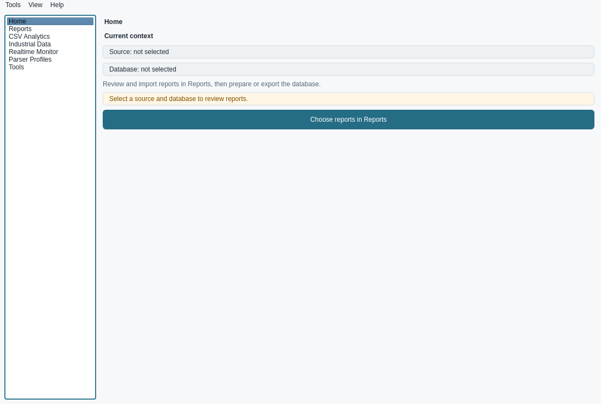

**Cel.** Punkt startowy: kontekst (źródło i baza), nawigacja do obszarów, zadania w tle.

**Zachować:**
- trwałą stronę Reports, która nie gubi pracy przy przełączaniu stron;
- przywracanie ostatniej strony i motywu;
- ochronę przed zamknięciem w trakcie pracy;
- tryb kompaktowy (lista rozwijana zamiast paska poniżej 1000 px).

**Problemy:**
- Home w 2/3 jest pusty. Jedyny przycisk, „Choose reports in Reports”, prowadzi do Reports, a po udanym imporcie nigdy nie proponuje Exportu (**A1-F08**).
- Pięć z siedmiu stron to jedno zdanie i jeden przycisk. Menu Tools tylko przełącza stronę (**A1-F05**).
- Brak menu File, ostatnich baz i skrótów (**C-F02**, **C-F01**).
- Zadanie wzbogacania metadanych:
  - potrafi pokazać zielone „complete” po anulowaniu (**A2-F03**, P1);
  - nie pokazuje, której bazy dotyczy (**A1-F03**);
  - zamknięcie aplikacji w trakcie wzbogacania nie jest ponawiane po jego zakończeniu (**A1-F02**).
- Ostrzeżenie o zablokowanym Exporcie zostaje po jego zamknięciu (**A1-F04**).
- Ścieżki na Home nie mają akcji „Kopiuj” (**A1-F13**).

**Kierunek.** Home jako **„pulpit dnia”** (propozycja R1): ostatnie bazy i foldery, nowe raporty w ostatnim folderze, ostatnie wyniki z przyciskami „Otwórz”, kolejny krok z klawiszem skrótu. Pozycje menu Tools otwierają okna od razu.

### 4.2 Reports: przegląd i import (ocena 3,6, planer 3,4)

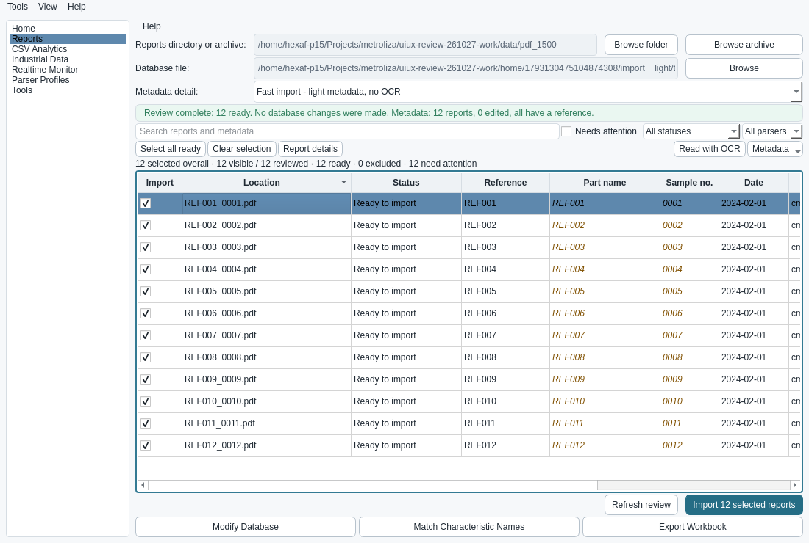
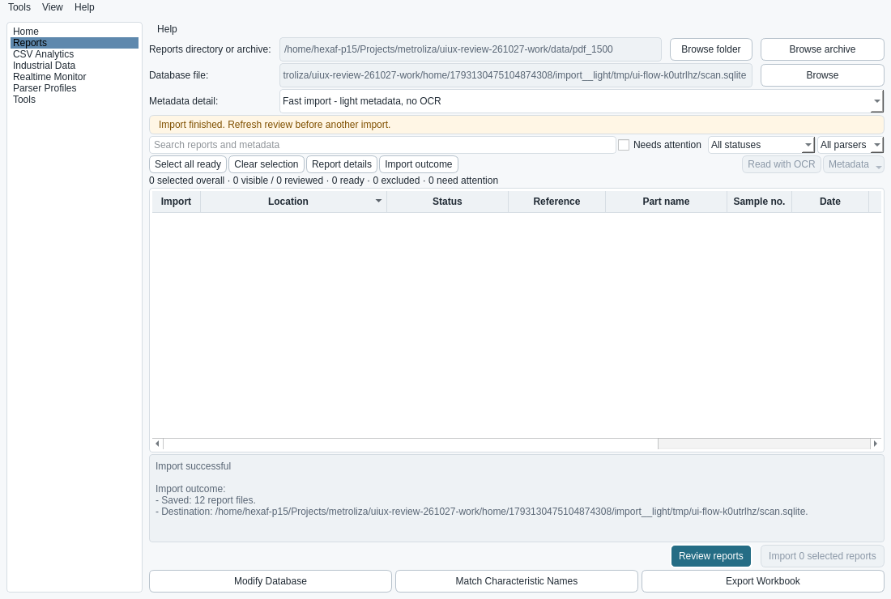

**Cel.** Wybrać źródło i bazę, przejrzeć raporty, poprawić metadane i zaimportować dokładnie wybrane.

**Zachować:**
- przegląd bez zapisu do bazy i ponowną weryfikację przy imporcie;
- globalne zaznaczenie niezależne od filtrów oraz licznik na przycisku „Import N selected reports”;
- nieaktywne wiersze duplikatów i nieobsługiwanych formatów;
- odczyt metadanych w tle, OCR, który nie nadpisuje ręcznych wartości, szczegóły parsera.

**Problemy:**
- `.sqlite` zamienia się w `.sqlite.db` (**A2-F01**).
- „Copy to checked” obejmuje wiersze ukryte filtrem i nie da się go cofnąć (**A2-F02**).
- Po imporcie tabela jest pusta, poprawki znikają, nie ma wyniku per raport (**A2-F04**). Głównym przyciskiem znów jest „Review reports”, a pasek statusu jest bursztynowy mimo sukcesu (**A2-F11**).
- Postęp i Cancel są tylko w osobnym oknie i na Home, a w samym Reports ich nie ma (**A2-F08**).
- „Ready to import” stoi obok „need attention” przy tych samych wierszach. Bursztynowa kursywa nie ma legendy (**A2-F06**).
- Pola z OCR (Time, Revision, Operator, Comment) są ukryte, a odsłania je tylko menu kontekstowe nagłówka (**A2-F07**).
- Zmiana trybu metadanych po cichu kasuje poprawki (**A2-F05**).
- Błędy nie podają przyczyny ani następnego kroku (**A2-F09**).
- Kolejność Tab przechodzi przez dolne akcje przed polami źródła (**A1-F06**, **A2-F10**).

**Kierunek.** **Pasek operacji** w Reports (etap, licznik, Cancel). Po imporcie **tabela wyniku**: Saved, Already present, Failed, Changed. Po sukcesie główną akcją jest **Export**. Osobne „Otwórz istniejącą bazę” i „Nowa baza”. Liczba wierszy i „Cofnij” przy masowym kopiowaniu. Menu „Columns…” (propozycja R2).

### 4.3 Okno postępu („kaczka”) i komunikaty (ocena 3,3–3,6)

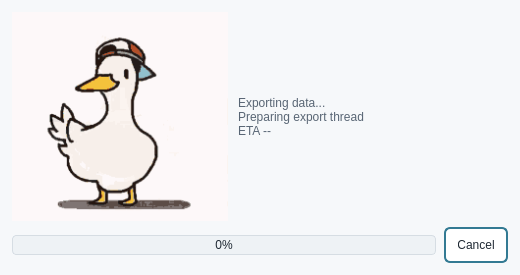

**Zachować:**
- opóźnione pokazanie okna, żeby nie migało przy krótkich zadaniach;
- anulowanie kooperacyjne z komunikatem „Cancel requested… waiting”;
- kaczkę, bo to celowy element marki.

**Problemy:**
- Tekst etapu jest mały, szary i techniczny („Preparing export thread”, „ETA --”).
- Okno postępu eksportu jest modalne dla całej aplikacji.
- W ciemnym motywie GIF zostawia jasny prostokąt (A1, obserwacja).

**Kierunek.** Tekst etapu i licznik „x z N” jako najważniejszy element okna, kaczka obok jako mniejsza ilustracja. Język użytkownika: „Przygotowanie danych”, „Rysowanie wykresów 12/37”. Ten sam postęp ma być widoczny w oknie, z którego operację uruchomiono.

### 4.4 Export (ocena 3,0)

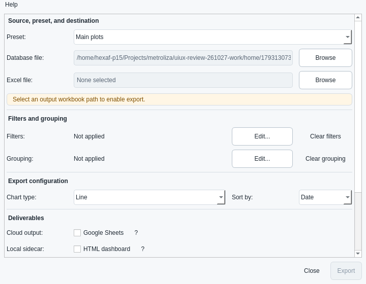
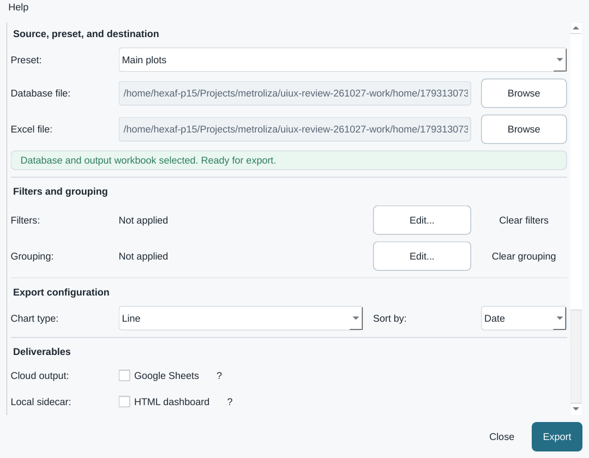
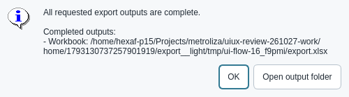

**Cel.** Skonfigurować i uruchomić eksport do Excela i HTML z bazy.

**Zachować:**
- jedno kompaktowe okno bez kreatora (decyzja produktowa);
- bazę przekazywaną z Reports;
- podsumowanie filtrów z referencjami i datami;
- „Edit…” i „Clear”;
- automatyczny HTML przy grupowaniu;
- Enter jako Export;
- atomowy zapis;
- rozróżnienie wyników „complete / omissions / failed / cancelled”.

**Problemy:**
- **Ciche nadpisanie poprzedniego pliku**, także po zmianie bazy (**A3-F01**, P1).
- Podsumowanie „co powstanie” jest poniżej widocznej części okna, także przy 150% (**A3-F02**).
- Ścieżki pokazują początek folderu zamiast nazwy pliku (**A3-F03**).
- Brak „Otwórz skoroszyt” i „Otwórz dashboard”. Wynik znika po zamknięciu komunikatu (**A3-F04**).
- Grupowanie widać tylko jako „Applied”, bez liczby i nazw grup (**A3-F05**).
- Po zamknięciu okna zostaje zapamiętany tylko preset (**A3-F06**).
- Pola zaawansowane po cichu zamieniają błędne liczby (**A3-F08**). Przełączenie opcji zaawansowanych resetuje rozmiar okna (**A3-F09**).
- „Local sidecar” to żargon.

**Kierunek.** Propozycja R3:
- trzy zwarte regiony (Źródło i wyjście, Zakres danych, Co powstanie);
- przypięte podsumowanie nad stopką;
- nazwa wyjścia z datą i jawne „Zastąp / Zapisz kopię”;
- pasek **„Ostatni eksport”** z przyciskami Otwórz;
- zapamiętywanie bezpiecznych ustawień.

### 4.5 Filtr eksportu (ocena 3,1)

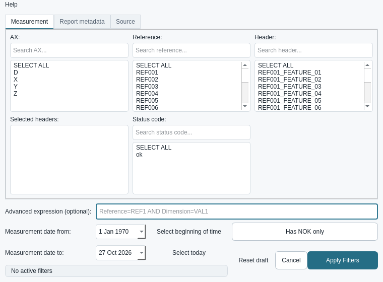

**Zachować:**
- karty Measurement / Report metadata / Source (dane są naturalnie podzielone);
- wyszukiwanie w każdej liście;
- podsumowanie aktywnych filtrów;
- osobne „Reset draft”, „Cancel” i „Apply Filters”.

**Problemy:**
- Wyszukiwanie lub zmiana Reference **czyści wybrane nagłówki** (**A4-F01**, P1).
- „SELECT ALL” jest pozycją listy, a zaznaczone razem z wartościami znosi filtr (**A4-F05**).
- Data „od” ma domyślnie 1 Jan 1970, nie ma szybkich zakresów. „Od” może być późniejsze niż „do” (**A4-F10**).
- „Has NOK only” wybiera raporty z jakimkolwiek NOK, a nie wiersze NOK (**A4-F04**).
- Listy pokazują tylko ok. 6 pozycji, choć okno ma miejsce.
- Brak nazw dostępności i kolejności Tab (**A4-F11**).

**Kierunek.** Propozycja R4:
- „Wszystkie wartości” jako stan wyłączny, nie jako pozycja listy;
- zakresy dat jednym kliknięciem: Dziś, Wczoraj, 7 dni, Ten miesiąc, Wszystko;
- jawne „Raporty z NOK” i „Tylko wiersze NOK”;
- zachowanie nagłówków przy zmianie referencji, z widocznym ostrzeżeniem, gdy któryś przestaje pasować.

### 4.6 Grupowanie eksportu (ocena 2,9)

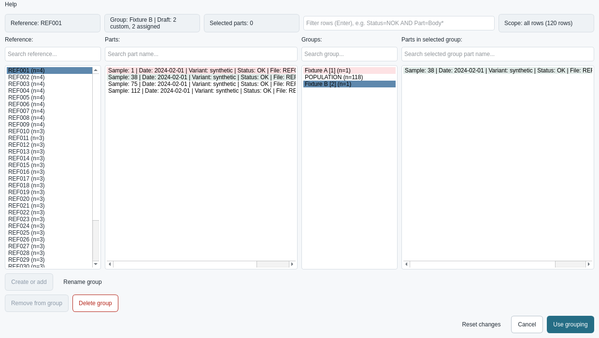

**Zachować:**
- cztery panele: referencja, części, grupy, członkowie;
- POPULATION jako grupa domyślna;
- podsumowania nad panelami;
- filtr wierszy z wyrażeniem;
- „Reset changes”, „Cancel” i „Use grouping”.

**Problemy:**
- Zmiana nazwy na istniejącą **łączy grupy** (**A4-F02**).
- „Create or add” zależy od fokusu (**A4-F03**).
- Części to **długie napisy „Sample | Date | … | File”** zamiast tabeli (**A4-F06**).
- Brak zapisu grupowania na następny dzień (**A4-F07**).
- Podgląd jest ucięty do 1000 wierszy, a wyszukiwanie nie sięga dalej (**A4-F08**).
- Instrukcja opisuje „Clear grouping”, którego w oknie nie ma (**A4-F09**).
- Przyciski akcji są daleko od paneli, których dotyczą.

**Kierunek.** Propozycja R5:
- tabela części z kolumnami (Sample, Data, Part/Rev, Status, Grupa, Plik), sortowanie i szerokości;
- akcja „Przypisz N zaznaczonych → [grupa]” przy panelu;
- grupy z kolorem i licznością;
- „Zapisz / Wczytaj grupowanie” z podglądem dopasowania.

### 4.7 Modify Database (ocena 2,6, najniższa)

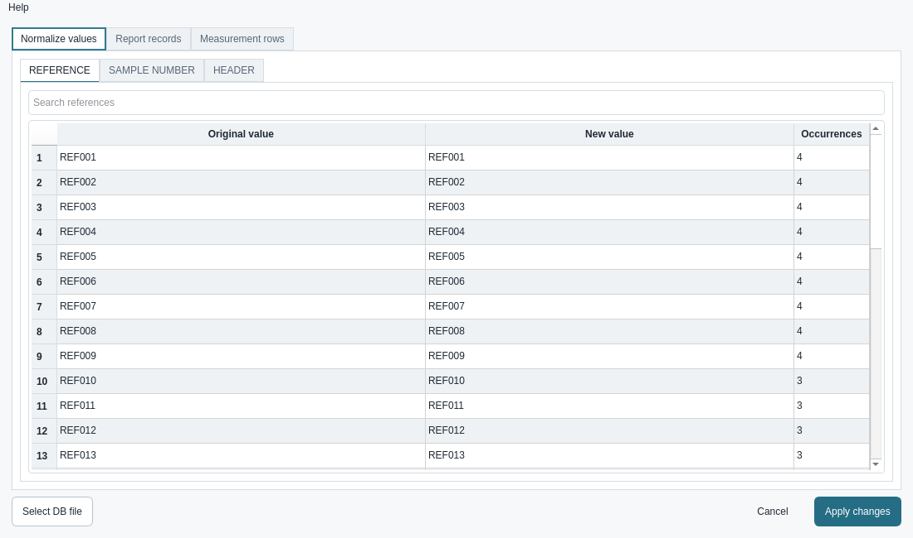
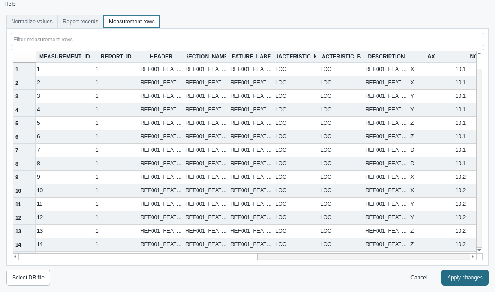

**Zachować:**
- karty Normalize values / Report records / Measurement rows;
- oryginał tylko do odczytu obok nowej wartości z liczbą wystąpień;
- przegląd zmian przed zapisem;
- ładowanie w tle.

**Problemy:**
- „10,25” zapisuje się jako pusta wartość (**A5-F01**, P1).
- Zapis nie jest atomowy (**A5-F02**, P1).
- Nie widać, która baza jest edytowana, ani dlaczego tabela jest pusta (**A5-F04**).
- Wybór bazy dopisuje `.db` (**A5-F05**).
- Ściśnięte kolumny, brak przejścia od raportu do jego pomiarów (**A5-F06**).
- **Brak licznika zmian, oznaczenia zmienionych komórek i cofania pojedynczej zmiany.** „Apply” jest aktywne bez zmian (**A5-F07**).
- Zmiana nazwy wielu wartości działa tylko przez Enter (**A5-F08**).

**Kierunek.** Propozycja R6:
- pasek kontekstu (baza, liczba raportów i pomiarów);
- „N zmian oczekuje”, zaznaczenie zmienionych komórek, widok „tylko zmienione”, „Cofnij zaznaczone”;
- walidacja liczb z jasną polityką przecinka;
- jedna transakcja zapisu;
- przycisk „Zmień nazwę zaznaczonych… (Enter)”.

### 4.8 Match Characteristic Names (ocena 3,3) i edytor dopasowania (3,1)

**Zachować:**
- zasięg dopasowania (wszystkie referencje albo jedna);
- informację o skutkach (liczba wierszy, raportów i referencji);
- walidację CSV z raportem naprawczym;
- domyślne „No” przy usuwaniu.

**Problemy:**
- Import CSV **nadpisuje istniejące reguły** bez podglądu (**A5-F03**).
- Okno jest **modalne** (**A5-F13**).
- Zapisanych dopasowań nie da się wyszukiwać (**A5-F09**).
- „Save” jest aktywne przy pustych polach. Duplikat wykrywa się dopiero po zamknięciu edytora (**A5-F10**).
- Przyciski bez ról: „Browse DB” jest domyślny, a „Save”, „Clear” i „Cancel” są równorzędne (**A5-F12**).

**Kierunek.** Podgląd importu CSV (Dodane, Zastąpione, Bez zmian). Okno niemodalne przez koordynatora. Wyszukiwanie w zapisanych dopasowaniach. Walidacja w edytorze przed zamknięciem.

### 4.9 CSV Summary (ocena 3,0)

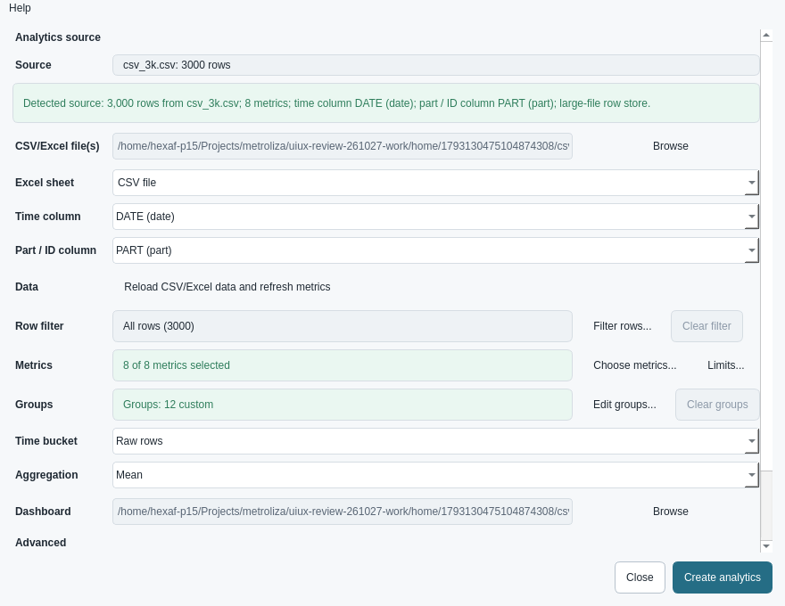

**Cel.** Analiza CSV lub Excela bez importu do bazy: filtr, metryki, limity, grupy, dashboard i opcjonalny skoroszyt.

**Zachować:**
- ładowanie po wyborze pliku i wykrywanie kolumn czasu i ID;
- filtr przekazywany do całej analizy;
- domyślny dashboard HTML;
- jeden główny przycisk „Create analytics”;
- tekstowe powody nieaktywnego przycisku.

**Problemy:**
- Limity odznaczonych metryk znikają (**A6-F01**).
- Zmiana filtra kasuje grupy (**A6b-F01**, też **A6-F02**).
- Zmiana kolumny czasu lub ID kasuje całą konfigurację (**A6-F03**).
- Brak receptur i „użyj ostatnich ustawień” (**A6-F04**).
- Objaśnienie gotowości i „Advanced” są poniżej widocznej części okna (**A6-F05**).
- Ścieżki bez nazwy pliku (**A6-F06**).
- Opcje interaktywności nie mówią, że statystyki liczą się ze wszystkich wierszy, a wykres pokazuje próbkę (**A6-F07**).
- „Select all” i „Clear” w metrykach działają także na ukrytych pozycjach (**A6-F08**).
- Po zamknięciu komunikatu nie zostaje „ostatni wynik” (**A6-F11**).
- Wszystkie akcje konfiguracji wyglądają jak tekst (**C-F05**). Okno jest modalne (**C-F03**).

**Kierunek.** Propozycja R7:
- **pasek receptury** („Receptura: Linia A – dzienna · Zapisz · Użyj ostatniej”);
- zwarte wiersze stanu z przyciskami z ramką;
- gotowość przy stopce;
- „Ostatni wynik” z przyciskami Otwórz;
- zachowywanie zgodnych grup i limitów przy zmianie filtra lub kolumn.

### 4.10 Filtr i grupowanie CSV (oceny 3,1 i 2,9)

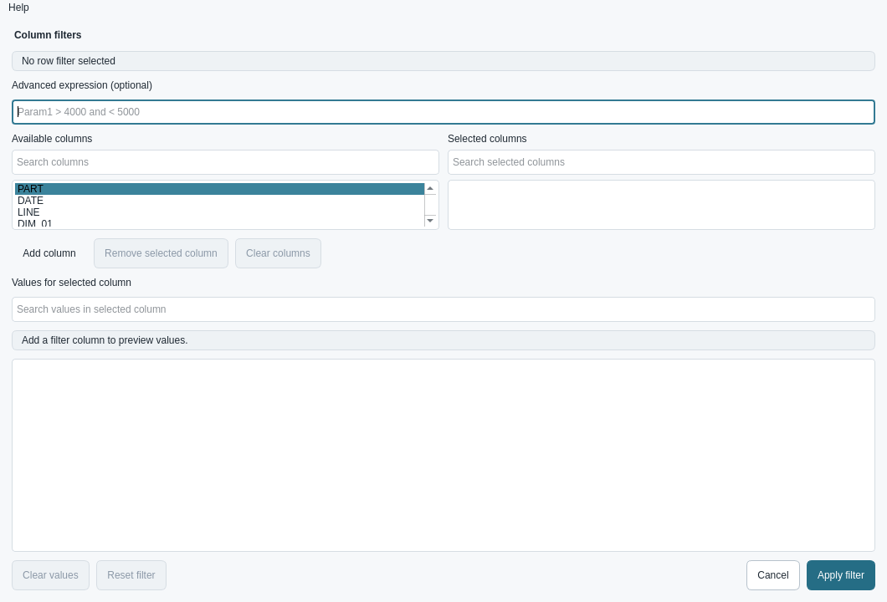
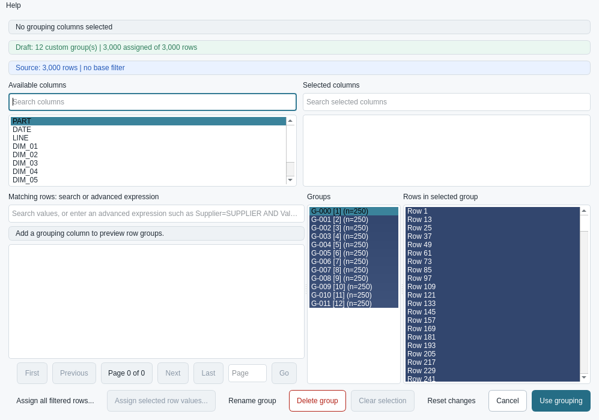

**Zachować:**
- oryginalne nazwy kolumn;
- opcjonalne wyrażenie z walidacją;
- daty ISO tylko dla kolumn z datą;
- przypisanie wszystkich pasujących stron;
- ochronę szkicu przed Esc.

**Problemy:**
- „Assign all filtered rows” ignoruje wpisane, niezatwierdzone wyszukiwanie (**A6b-F02**, P1).
- Członkowie grupy to „Row N”, bez wyszukiwania, ucięci do 1000 (**A6b-F03**).
- Usuwanie członka działa tylko przez Delete (**A6b-F04**).
- Dodanie kolumny działa tylko przez podwójne kliknięcie (**A6b-F05**).
- „Clear values” czyści też datę (**A6b-F06**).
- Lista kolumn ma 60 px wysokości (**A6b-F07**).
- Instrukcja opisuje kombinacje wartości, a UI łączy kolumny przez AND (**A6b-F08**).
- Osiem akcji w jednej stopce (**A6b-F09**).

**Kierunek.**
- Wspólny wzorzec z oknami bazy: tabela członków z identyfikatorem części i plikiem, widoczne „Usuń z grupy”.
- Wyszukiwanie z widocznym stanem „nie zastosowano — Enter”.
- Układ dwukolumnowy: warunki po lewej, wartości po prawej.

### 4.11 Opcje wizualne dashboardu i interaktywność (ocena 3,7 / 3,4 / 3,1)

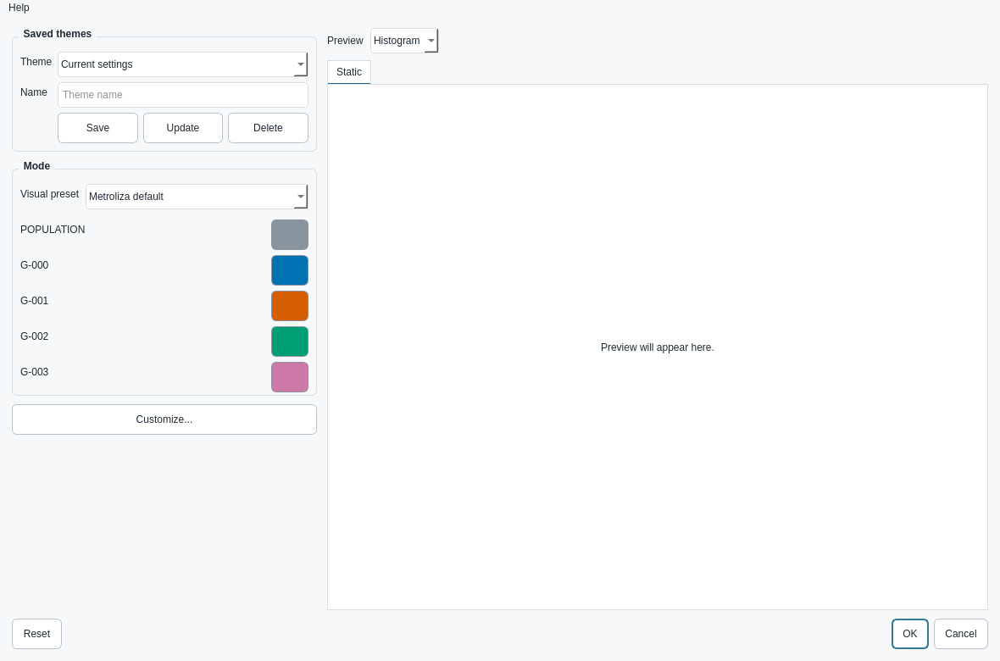

Zestaw receptur i panel własnych ustawień pozwalają zmienić wygląd bez zmiany danych. Uwagi:
- podgląd stylu bez ostrzeżenia pokazuje tylko 4 grupy, nawet gdy wynik ma 12, więc późniejszych grup nie da się wybrać do stylowania (**A7-F01**);
- usunięcie zapisanego motywu zapisuje się od razu, a Cancel go nie przywraca (**A7-F02**);
- ustawienia interaktywności i warstw nie mówią, co tracimy: najechanie, zaznaczanie punktów, kolory statyczne (**A7-F03**, też A6-F07);
- „Customize” otwiera się z przeważnie nieaktywnymi kontrolkami bez wyjaśnienia (**A7-F04**);
- zaznaczenia punktów w HTML zapisują się tylko w tej przeglądarce i nikt o tym nie mówi (**A7-F05**);
- próbki kolorów nie mają nazw dostępności (**A7-F06**).

### 4.12 Industrial Data (skrót, niższy priorytet)

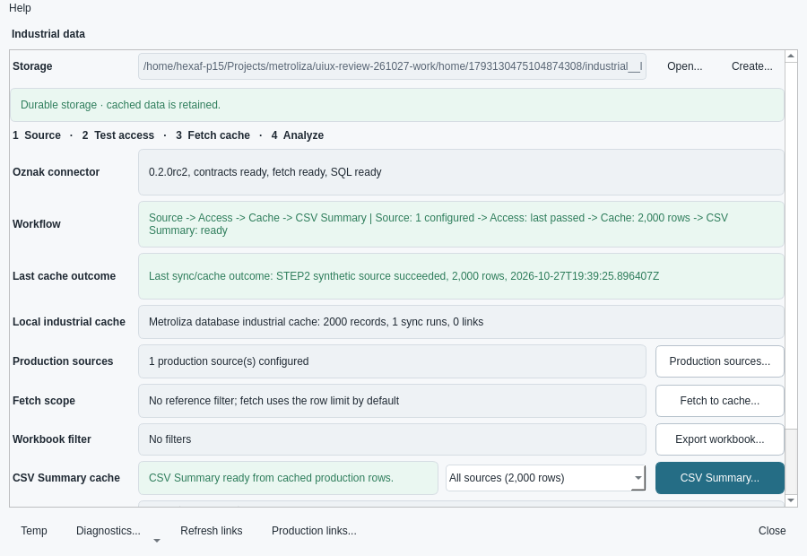

Kompaktowy launcher z paskiem „Source → Access → Cache → CSV Summary” jest czytelny. Uwagi:
- formularz filtra analityki ma 870 px wysokości i nie ma przewijania, więc na ekranie 720 px się nie mieści (**A8-F01**);
- instrukcja wskazuje sprawdzanie połączenia w złym oknie (**A8-F02**);
- tabele porównania powiązań wymagają przewijania w poziomie (**A8-F03**).

### 4.13 Realtime, incydenty, profile parserów, BOM (skrót)

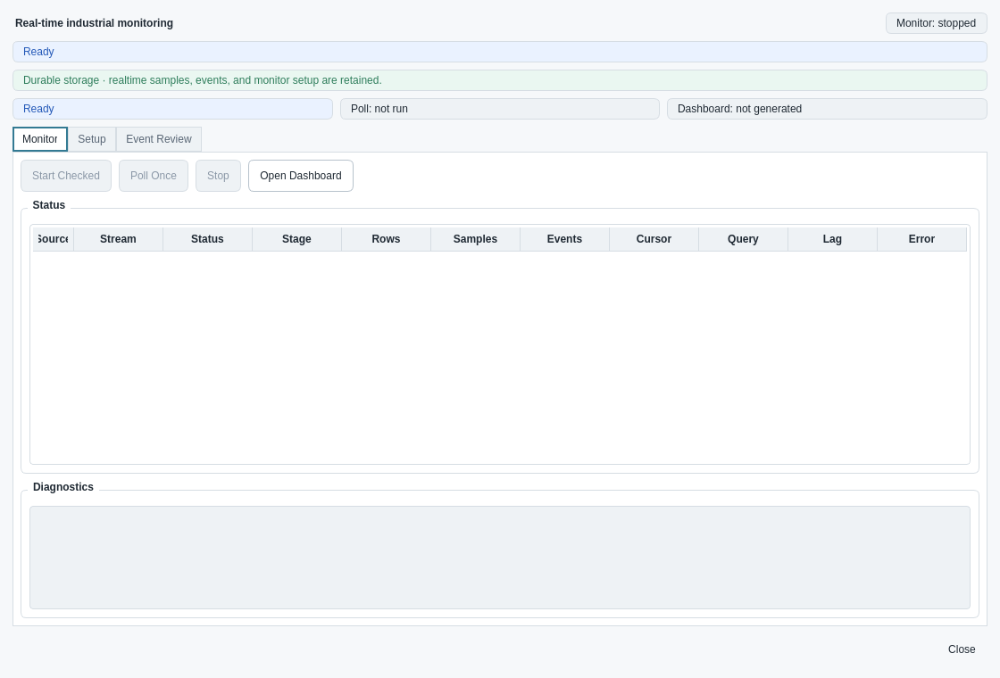

- **Realtime.** Wielowierszowy edytor sygnałów ma 30 px wysokości (**A9-F01**).
- **Parser Profiles.** „Install” staje się aktywne razem z „Check Package” i „Validate”, przed przeglądem (**A9-F02**).
- **BOMManager.** Nie ma do niego drogi z menu. To okno zgodności do rozważenia przy porządkach.

### 4.14 About, Release notes, ekran startowy, Help

- About i ekran startowy są w porządku (4,3 / 3,7).
- Release notes to jeden gęsty strumień obecnej wersji i archiwum. Wystarczy krótkie podsumowanie, grupy według obszarów i link do archiwum (**A1-F12**).
- Menu Help jest w każdym oknie i to warto zachować. Brakuje F1 do instrukcji kontekstowej.

## 5. Wyniki pracy: Excel i dashboardy HTML (skrót)

Ekspert ocenia Metrolizę także po tym, co otwiera na końcu. Sprawdziliśmy prawdziwe pliki wygenerowane z danych syntetycznych:
- skoroszyt eksportu: 120 raportów, 38 arkuszy, 6 MB;
- dashboard CSV Summary: zwykły i z 12 grupami;
- skoroszyt CSV Summary: 13 arkuszy.

Zastrzeżenie: dane nie zawierały wyników NOK, więc prezentację NOK oceniono z reguł i kodu.

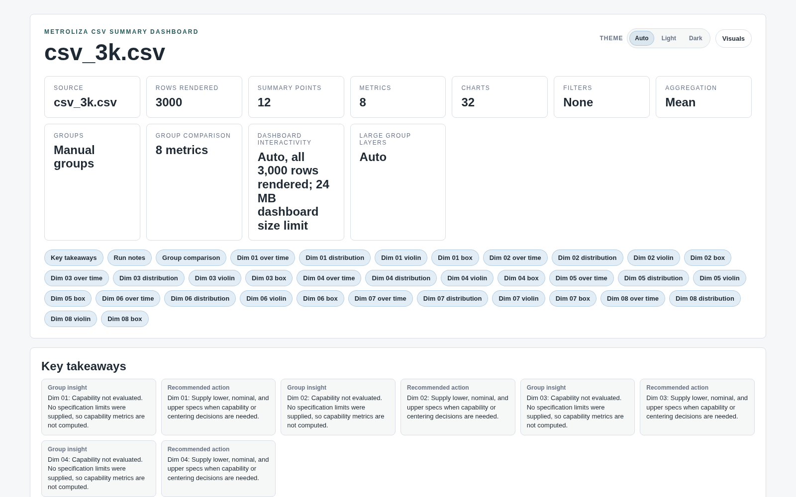

### 5.1 Skoroszyt eksportu (ocena 2,9)

**Zachować:**
- edytowalne natywne wykresy Excela;
- zamrożone wiersze nagłówka i statystyk;
- arkusz `MEASUREMENTS` z autofiltrem;
- liczby NOK i procent NOK obok formatowania warunkowego.

**Problem (O1-F01).** Plik otwiera się na `REF001`, a nie na przeglądzie. Ma 37 arkuszy referencji po 360 kolumn (72 bloki charakterystyk), bez linków wewnętrznych i bez zbiorczej listy „co jest NOK”. Ekspert, który nie wie z góry, gdzie szukać, przegląda bloki albo filtruje surową tabelę (kolumny AG/AH).

**Kierunek.** Arkusz **„Review”** na początku (R9): zakres, sumy, tabela referencja × charakterystyka z NOK i Cpk, posortowana od najważniejszych, z linkami do bloków.

### 5.2 Dashboard HTML: Group Analysis i CSV Summary (ocena 3,3)

**Zachować:**
- dashboard jako główna powierzchnia analizy grupowej;
- „Key takeaways” i „Recommended action” przy metrykach;
- jawne ostrzeżenia, zakres i ograniczenia;
- działanie offline;
- „Back to dashboard start”;
- zwinięte tabele szczegółów.

**Problemy (sprawdzone na zrzutach z przeglądarki):**
- **Pierwszy ekran to ustawienia, a nie wyniki.** Kafelki Filters, Aggregation, Dashboard interactivity („Auto, all 3,000 rows rendered; 24 MB dashboard size limit” dużą czcionką) i Large group layers zajmują górę strony (**C-F06**).
- **Ściana nawigacji.** 34–37 chipów „Dim 01 over time / distribution / violin / box…” bez oznaczenia, które metryki wymagają uwagi, i bez wyszukiwania (**O1-F03**).
- **Powtarzające się wnioski.** Bez limitów specyfikacji każda metryka dostaje tę samą parę kart „Capability not evaluated / Supply lower, nominal and upper specs”: 16 kart dla 8 metryk (**C-F07**).
- **Porównanie grup jest zwinięte.** Sekcja „Group comparison”, czyli cel analizy grupowej, jest domyślnie zwinięta. Dalej idzie długa kolumna czterech wykresów na metrykę z paskiem „Find point” pod każdym (**C-F08**).
- **Kolory grup się powtarzają.** Domyślna paleta ma 6 kolorów, więc przy 12 grupach G-000 i G-006 mają ten sam kolor (**C-F09**).
- **Brak daty wygenerowania.** Dashboard CSV nie pokazuje „Wygenerowano” ani „Dane do” (**O1-F06**).
- **Zasoby obok pliku.** HTML potrzebuje folderu z zasobami, a komunikat zakończenia tego nie mówi (**O1-F05**).
- **Zaznaczenia tylko lokalnie.** Zaznaczenia punktów i style zapisują się tylko w tej przeglądarce (**A7-F05**).

**Kierunek.** Dashboard **„najpierw wyniki”** (R8):
- tabela uwagi z wyszukiwaniem;
- porównanie grup rozwinięte;
- jeden zbiorczy komunikat o brakujących limitach;
- rozszerzona paleta powyżej 6 grup;
- ustawienia w zwiniętych „Notatkach z przebiegu”.

### 5.3 Skoroszyt CSV Summary (efektywność i spójność 2/5)

Arkusze danych otwierają się bez zamrożonego nagłówka, bez autofiltra i z domyślnymi szerokościami kolumn. Skoroszyt eksportu bazy ma te elementy, CSV Summary nie (**O1-F04**). Wystarczy wspólna polityka tabel dla obu skoroszytów: nagłówek, filtr, szerokości, formaty i „Review” na początku.

### 5.4 Zakończenie i dostęp do wyniku

- **Export:** komunikat z pełną ścieżką i przyciskiem „Open output folder”.
- **CSV Summary:** komunikat z linkiem `file://` do HTML.

W obu przypadkach po zamknięciu komunikatu nie zostaje „ostatni wynik” (**A3-F04**, **A6-F11**). Propozycja: wspólny pasek **„Ostatni wynik”** w obu oknach i na Home, z przyciskami Otwórz skoroszyt, Otwórz dashboard i Pokaż w folderze, oraz notatką „zachowaj HTML razem z folderem zasobów” lub akcją „Zapisz paczkę .zip” (**O1-F05**).

### 5.5 Sygnał do programu wydajności (nie ustalenie UX)

Eksport z grupowaniem i Group Analysis nie skończył się w limicie: 20 minut dla 120 syntetycznych raportów oraz 7 i 10 minut dla 30 raportów (także w trybie „HTML dashboard only”). Środowisko: Linux, kod źródłowy, zwykłe obciążenie maszyny.

Zrzuty stosu co minutę pokazywały aktywne renderowanie wykresów podsumowań w puli procesów (`export_summary_render_pool.py` → `summary_sheet_fill` → plotstats i matplotlib), a nie zawieszenie. To nie był kontrolowany pomiar, więc nie wyciągamy wniosku o produkcie. Warto jednak sprawdzić ten przypadek w kolejnym programie wydajności. Dla UX oznacza to, że długi eksport z grupami musi mieć bardzo dobry postęp, z etapem i licznikiem wykresów, i pozwalać pracować dalej w innych oknach.

## 6. Propozycje zmian

### 6.1 Proponowana kolejność (fale)

| Fala | Cel | Zawartość | Wysiłek łącznie |
|---|---|---|---|
| **0. Bezpieczeństwo danych w UI** | Żadnych cichych nadpisań i zmian zakresu | **16 pozycji: 6 × P1 + 9 × P2 + A4-F10 jako P3** (lista niżej). Prawie wszystkie są lokalne (S/M): walidacja, nazwanie skutku, cofnięcie, jedna transakcja | ~2 tygodnie |
| **1. Codzienna ścieżka** | Cel: z ~16 do szacowanych ~8–9 aktywacji w PDF→Excel (szacunek z kodu, nie wynik) | „Otwórz skoroszyt / dashboard” i pasek „Ostatni wynik” (A3-F04, A6-F11). Export jako krok po imporcie (A1-F08). Ostatnie bazy i foldery, menu File (C-F02). Nazwa wyjścia z datą i jawne „Zastąp” (A3-F01). Zakresy dat w filtrze. Pozycje menu Tools otwierają okna (A1-F05). Skróty i mnemoniki (C-F01) | ~2 tygodnie |
| **2. Pamięć ustawień** | Jutro kontynuuję dzisiejszą pracę | Zapamiętywanie bezpiecznych ustawień Exportu (A3-F06). Zapis i wczytanie grupowania (A4-F07). Receptury CSV Summary i „Użyj ostatnich” (A6-F04). Zachowywanie zgodnych grup i limitów (A6-F02, A6-F03) | ~2–3 tygodnie |
| **3. Przebudowy okien** | Gęstość i czytelność | Home jako „pulpit dnia” (R1). Reports z tabelą wyniku i paskiem operacji (R2). Grupowanie na tabelach (R5). Modify DB z licznikiem zmian (R6). Dashboard „najpierw wyniki” (R8). Arkusz „Review” w Excelu (R9) | ~4–6 tygodni |
| **4. Spójność i dostępność** | Jeden język w całej aplikacji | Polityka ról przycisków (C-F05, A1-F10). Terminologia (A1-F09). CSV Summary i dopasowanie nazw niemodalne (C-F03). Kolejność Tab i nazwy (A2-F10, A3-F07, A4-F11, A5-F11, A6-F09). Instrukcje (A4-F09, A6b-F08, A8-F02, A1-F11) | ~1–2 tygodnie, równolegle |

**Zakres fali 0 (jawna lista, 16 pozycji).** Identyfikatory zostają bez zmian; ustalenia scalone (A1-F01 w A2-F03, A6-F02 w A6b-F01) nie są osobnymi zadaniami.
- **P1 (6):** A3-F01, A2-F03, A4-F01, A5-F01, A5-F02, A6b-F02.
- **P2 (9):** A2-F01, A5-F05, A2-F02, A4-F02, A4-F03, A4-F05, A5-F03, A6-F01, A6b-F01.
- **P3 (1):** A4-F10, wyłącznie walidacja zakresu dat „od ≤ do”. Szybkie okresy dat zostają w fali 1.

Szacunki są orientacyjne, dla jednej osoby z Codexem. Fale 0 i 1 dają największy zwrot: usuwają ryzyko złych danych i skracają codzienną ścieżkę.

### 6.2 Szybkie wygrane (S, do 1 dnia każda)

1. Zachować dokładną nazwę wybranej istniejącej bazy; `.db` dopisywać tylko do nowej nazwy bez rozszerzenia (**A2-F01**, **A5-F05**).
2. Blokować zmianę nazwy grupy na istniejącą albo jawnie pytać o scalenie (**A4-F02**).
3. Walidować „od ≤ do” w filtrze. Ustawić „Wszystkie wartości” jako stan wyłączny zamiast pozycji „SELECT ALL” (**A4-F10**, **A4-F05**).
4. Dodać przyciski **Open workbook / Open dashboard / Show in folder** w komunikacie zakończenia (**O1-F02**, początek A3-F04).
5. Po udanym imporcie przenieść wyróżnienie na **Export Workbook**, a „Review reports” zostawić jako drugorzędne. Pasek statusu zielony przy sukcesie (**A1-F08**, **A2-F11**).
6. Pozycje menu Tools otwierają okno od razu. Jedna nazwa: „CSV Summary” (**A1-F05**).
7. Pola ścieżek pokazują **nazwę pliku** z elipsą w środku folderu (**A3-F03**, **A6-F06**, **A1-F13**).
8. Zmienić etykiety:
   - „Has NOK only” → „Raporty z jakimkolwiek NOK” (**A4-F04**);
   - „Local sidecar” → „HTML dashboard”;
   - „Clear values” → „Clear column condition” (**A6b-F06**).
9. Pokazywać bazę docelową w pasku wzbogacania metadanych. Usuwać ostrzeżenie o zablokowanym Exporcie po jego zamknięciu (**A1-F03**, **A1-F04**).
10. Dodać przyciski: **Rename selected… (Enter)** w Modify DB (**A5-F08**), **Remove from group** i **Add column** w grupowaniu CSV (**A6b-F04**, **A6b-F05**).
11. Skróty i mnemoniki (**C-F01**):

    | Skrót | Akcja |
    |---|---|
    | Ctrl+1…7 | Strony paska bocznego |
    | Ctrl+O | Otwórz bazę |
    | Ctrl+R | Review reports |
    | Ctrl+I | Import |
    | Ctrl+E | Export |
    | Ctrl+F | Szukaj w tabeli |
    | F1 | Instrukcja okna |
    | Alt+litera | Przyciski w oknach |

    Przed wyborem trzeba sprawdzić kolizje z istniejącą obsługą klawiszy.
12. Skoroszyt CSV: zamrożony nagłówek, autofiltr, szerokości kolumn (**O1-F04**). Dashboard CSV: „Wygenerowano” i „Dane do” (**O1-F06**).
13. Poprawić instrukcje tam, gdzie rozjechały się z UI (**A4-F09**, **A6b-F08**, **A8-F02**, **A1-F11**).

### 6.3 Większe propozycje (R1–R9)

Każda propozycja ma w rozdziale 8 gotowy opis do wygenerowania wizualizacji.

**R1. Home jako „pulpit dnia”** (rozwiązuje A1-F08, C-F02, A1-F05, A1-F13; M)

Zamiast pustej strony Home cztery zwarte bloki:
1. **Kontynuuj**: ostatnia baza i folder raportów, z informacją „12 nowych raportów od wczoraj · Przejrzyj i importuj (Ctrl+R)”.
2. **Ostatnie wyniki**: ostatni eksport i ostatnie CSV Summary, z przyciskami Otwórz skoroszyt, Otwórz dashboard i Pokaż w folderze.
3. **Ostatnie bazy**: 5 pozycji, przypinanie.
4. **Szybkie akcje** z klawiszami: Export, CSV Summary, Modify DB.

Pasek boczny zostaje, ale strony-launchery otwierają okno od razu albo pokazują ostatnio użyte pliki danego obszaru.

**R2. Reports: pasek operacji i tabela wyniku** (A2-F04, F06–F09, F11; M–L)
- Pod trzema wierszami kontekstu jest pasek operacji: etap, „x/N”, ETA, Cancel, a po anulowaniu „zapisane raporty zostają”.
- Po imporcie tabela nie znika. Pokazuje wynik per raport (Saved, Already present, Failed, Changed) z filtrami i powodem przy błędzie.
- Główny przycisk po sukcesie to Export Workbook.
- Licznik „12 do importu · 3 ostrzeżenia metadanych” z filtrem jednym kliknięciem.
- Menu „Columns…” z presetem „Pola OCR”.
- Baza: „Otwórz istniejącą…” i „Nowa…” ze znacznikiem Istniejąca / Nowa.

**R3. Export: zakres i wynik zawsze na widoku** (A3-F01–F06; M)
- Trzy zwarte regiony:
  - Źródło i wyjście: nazwa wyjścia z datą, „Zapisz jako…”, stan „Nowy plik / Istniejący — zostanie zastąpiony”;
  - Zakres danych: filtry i „2 grupy niestandardowe · 24 przypisane · 96 POPULATION”;
  - Co powstanie: skoroszyt, HTML (wymagany przy grupowaniu), styl dashboardu.
- Nad stopką przypięte dwie linie podsumowania.
- Pod nimi pasek **„Ostatni eksport · ukończony · 14:32”** z przyciskami Otwórz dashboard, Otwórz skoroszyt i Pokaż w folderze.
- Zapamiętane bezpieczne ustawienia z oznaczeniem „Main plots · zmieniony”.

**R4. Filtr: zakres jasny i stabilny** (A4-F01, F04, F05, F10; M)
- Każdy wymiar ma stan „Wszystkie” albo „Wybrane (n)” z licznikami wartości.
- Zakresy dat jednym kliknięciem: Dziś, Wczoraj, 7 dni, Ten miesiąc, Wszystko, Własny.
- Dwa jawne przełączniki: „Raporty z NOK” i „Tylko wiersze NOK”.
- Zmiana referencji nie kasuje nagłówków. Wartości, które przestały pasować, pokazuje ostrzeżenie.
- U dołu na żywo „Eksport obejmie: 3 referencje · 24 nagłówki · 27.10.2026”.

**R5. Grupowanie na tabelach** (A4-F02, F03, F06–F08; A6b-F03–F05; M–L)
- Części i członkowie jako tabele: Sample, Data, Part/Rev, Status, Grupa, Plik. Sortowanie, wyszukiwanie po całym zbiorze, „1000 z 4 812”.
- Przy panelach akcje „Przypisz 12 zaznaczonych → Lot B”, „Usuń z grupy”, „Zmień nazwę”.
- Lista grup z kolorem i licznością.
- „Zapisz grupowanie…” i „Wczytaj…” z podglądem dopasowania (dopasowane, brakujące, nowe raporty).
- Ten sam komponent w oknach bazy i CSV.

**R6. Modify DB: zmiany pod kontrolą** (A5-F01, F02, F04, F06–F08; M)
- Pasek kontekstu: baza, liczba raportów i pomiarów.
- „7 zmian oczekuje · Pokaż tylko zmienione · Cofnij zaznaczone”, zmienione komórki oznaczone tekstem i kolorem.
- Walidacja liczb z jawną polityką przecinka.
- Jedna transakcja i komunikat „Nic nie zapisano” przy błędzie.
- Przycisk „Zmień nazwę zaznaczonych… (Enter)”.
- „Pomiary wybranego raportu” jako przejście z karty raportów.

**R7. CSV Summary z recepturą** (A6-F01–F05, F11; M)
- U góry pasek receptury: „Receptura: Linia A – dzienna ▾ · Zapisz · Użyj ostatniej”.
- Zwarte wiersze stanu (Źródło, Wiersze, Metryki i limity, Grupy, Wyniki) z przyciskami z ramką.
- Gotowość przy stopce, „Ostatni wynik” z przyciskami Otwórz.
- Zmiana filtra lub kolumn pokazuje, co zostanie zachowane, a co odrzucone.
- Okno niemodalne.

**R8. Dashboard HTML: najpierw wyniki** (O1-F03, F06 i ustalenia A7; M)
- Pierwszy ekran to tabela uwagi: metryka, grupy, NOK, ostrzeżenia, zdolność, link do szczegółów. Sortowanie od najważniejszych, wyszukiwanie.
- Kafelki ustawień przeniesione do zwiniętych „Notatek z przebiegu”.
- Porównanie grup rozwinięte domyślnie.
- Jeden zbiorczy komunikat zamiast powtarzanych kart „brak limitów specyfikacji”.
- Unikalne kolory grup powyżej 8 grup.

**R9. Excel: arkusz „Review” na początku** (O1-F01, O1-F04; M)
- Pierwszy arkusz: zakres i źródło, wiersz sum, tabela referencja × charakterystyka z liczbą NOK, Cpk i linkiem do bloku. Autofiltr, sortowanie od najważniejszych.
- Wspólna polityka tabel dla obu rodzin skoroszytów: zamrożone nagłówki, filtry, szerokości, formaty.

## 7. Pytania do PO

Odpowiedzi ustalają kierunek fal 0–2. W nawiasach podano ustalenia, których dotyczy pytanie.

1. **Ponowny eksport.** Czy nadpisanie istniejącego pliku ma być świadomym, zapamiętanym wyborem dla pary baza–plik, czy domyślnie ma powstawać nowa kopia z datą lub numerem (A3-F01)?
2. **Przecinek dziesiętny.** Czy w Modify DB „10,25” ma być przyjmowane jako 10.25 z podglądem, czy odrzucane z komunikatem (A5-F01)? Puste ma nie znaczyć „wyczyść”, chyba że użytkownik naprawdę wyczyścił komórkę.
3. **Co zapamiętywać na jutro.** Które ustawienia Exportu (typ wykresu, sortowanie, HTML, opcje zaawansowane), grupowania (te same raporty czy reguły dla nowych partii) i CSV Summary (mapowanie, limity, filtry, grupy, folder wyjścia) mają przetrwać zamknięcie okna? Automatycznie czy jako nazwane receptury (A3-F06, A4-F07, A6-F04)?
4. **Krok po imporcie.** Czy po udanym imporcie wyróżniamy Export Workbook, a Modify Database i ponowny przegląd zostają drugorzędne (A1-F08)?
5. **Zmiana filtra a grupy.** Czy przy zmianie filtra zgodne przypisania do grup mają zostać zachowane, czy grupy mają być resetowane z jasnym komunikatem? Bez zmiany filtra grupy zostają zawsze (A6b-F01, A6-F02, A4).
6. **NOK w filtrze.** Czy szybki przełącznik ma oznaczać raporty z jakimkolwiek NOK, wiersze NOK, czy oba warianty mają być widoczne (A4-F04)?
7. **Jedna nazwa i modalność.** Czy „CSV Summary” może być jedyną nazwą (pasek, menu, okno, instrukcja)? Czy CSV Summary i Match Characteristic Names mogą działać niemodalnie jak Export (A1-F05, C-F03)?
8. **Skróty.** Na jakich skrótach klawiszowych użytkownicy już polegają (np. w tabelach), żeby nowe nie kolidowały (C-F01)?
9. **Excel i HTML.** Czy jakieś makra albo integracje zależą od kolejności i nazw arkuszy (wpływ na arkusz „Review”)? Czy HTML ma być udostępniany jako paczka .zip, czy jako pojedynczy plik (O1-F01, O1-F05)?
10. **Skala danych.** Ile typowo i maksymalnie jest referencji, nagłówków, grup, członków grup i metryk CSV? Od tego zależą tabele, stronicowanie i wyszukiwanie w oknach grupowania (A4-F08, A6b-F03).
11. **Weryfikacja na Windows.** Na którym buildzie (RC) sprawdzimy natywne okna wyboru plików, blokady plików Excela, skalowanie 125–150%, fokus i czytnik ekranu? Linux offscreen tego nie potwierdza.

## 8. Prompty do ChatGPT (wizualizacje propozycji)

**Jak użyć.** Najlepiej wkleić **wspólny styl + jeden prompt** i dołączyć obecny zrzut okna z `img/`, z prośbą „redesign this window as described”. Prompty są po angielsku, bo etykiety w aplikacji są angielskie, a generatory obrazów lepiej radzą sobie z tekstem po angielsku.

**Wspólny styl (wklej na początku każdego promptu):**
> Realistic high-fidelity screenshot of a Windows 11 desktop application called "Metroliza" for industrial metrology (CMM measurement reports). Native-looking PyQt controls, Segoe UI 9–10 pt, dense professional workbench layout, light theme: window background #F6F8FA, white surfaces, subtle #D6DDE3 borders, 4–6 px corner radius, charcoal text #1F2933, one blue-teal accent #256D85 for the single primary button and selection, status colours only for meaning (green #2E7D5B success, amber #B7791F warning, red #B42318 errors) always paired with text. Realistic data: references like "REF-1042", characteristics like "D1_DIAMETER", dates 2026-10-27, groups "Lot A", "Lot B". No marketing hero, no decorative illustrations, no web-style cards with large empty space. Keyboard shortcuts shown subtly next to actions.

**R1 — Home „pulpit dnia”**
> Main window 1280×800. Left: narrow sidebar (Home selected, Reports, CSV Summary, Industrial Data, Realtime Monitor, Parser Profiles, Tools) with shortcut hints Ctrl+1…7. Menu bar: File, Tools, View, Help. Content in four compact blocks: (1) "Continue" — database "Line_A_2026.db" and report folder "\\cmm-server\reports\2026-10-27" with an info line "12 new reports since yesterday" and primary button "Review & import (Ctrl+R)"; (2) "Last results" — rows "Export · 2026-10-26 16:42 · REF-1042_2026-10-26.xlsx" and "CSV Summary · line_a.csv · dashboard.html", each with small buttons "Open workbook", "Open dashboard", "Show in folder"; (3) "Recent databases" — five rows with pin icons; (4) "Quick actions" — Export workbook (Ctrl+E), CSV Summary, Modify database.

**R2 — Reports po imporcie**
> Reports workspace 1280×800 inside the main window. Top: three compact rows — Reports folder (path with middle ellipsis, Browse folder / Browse archive), Database "Line_A_2026.db" with a small "Existing" badge and buttons "Open existing…" / "New…", Metadata detail combo. Below: a slim green operation strip "Import complete · 12 saved · 2 already present · 0 failed · 14:32". Filter chips row: All results, Saved 12, Already present 2, Needs action 0. Dense table with columns Import result, Location, Reference, Part name, Sample no., Date, Parser — rows show "Saved" or "Already present". Bottom right: secondary "Review again", primary blue-teal "Export workbook (Ctrl+E)"; quieter "Modify database" and "Match characteristic names" on the left.

**R3 — Export z paskiem „Ostatni eksport”**
> Export window 820×680. Region "Source and output": Preset "Main plots · modified", Database "Line_A_2026.db", Output "REF-1042_2026-10-27.xlsx" with "Save as…" and an amber line "Existing file — Replace or Save a copy" with two small buttons. Region "Data scope": Filters "REF-1042, REF-1043 · Today" with Edit… and Clear; Grouping "2 custom groups · 24 assigned · 96 population" with Edit… and Clear. Region "Outputs": checkboxes Excel workbook, HTML dashboard (label "required for Group Analysis"), Dashboard style "Calm light · Change…"; Chart type and Sort by combos; collapsed "Advanced". Fixed bottom strip: "Last export · Complete · 14:32 · REF-1042_2026-10-27.xlsx, dashboard.html" with "Open dashboard", "Open workbook", "Show in folder"; footer "Close" and primary "Export (Enter)".

**R4 — Filtr**
> Filter dialog 900×640, tabs Measurement / Report metadata / Source. Each list (AX, Reference, Header, Status code) has a header line with a segmented toggle "All | Selected (3)", a search field and checkbox items with counts like "REF-1042 (48)". Date row with quick buttons "Today", "Yesterday", "Last 7 days", "This month", "All dates", "Custom…" and two date fields. Two explicit toggles: "Reports with any NOK" and "NOK measurement rows only". A small amber note: "2 selected headers are not available for REF-1043". Bottom live summary: "Export will include: 3 references · 24 headers · 2026-10-27"; footer "Reset", "Cancel", primary "Apply filters".

**R5 — Grupowanie na tabelach**
> Grouping dialog 1280×760. Left: Reference list with counts. Center: table "Parts" with columns Sample, Date, Part/Rev, Status, Group, File, sortable, 12 rows selected, header "1 000 of 4 812 shown · search all". Under it a toolbar "Assign 12 selected → [Lot B ▾]", "Create group…". Right top: Groups list with colour swatch and count ("Lot A · 24", "Lot B · 12", "POPULATION · 96") and buttons Rename, Delete. Right bottom: Members table (Sample, Date, File) with "Remove from group". Top bar: "Save grouping…", "Load grouping…". Footer: "Reset changes", "Cancel", primary "Use grouping".

**R6 — Modify Database ze zmianami pod kontrolą**
> Modify Database window 1280×760, tabs Normalize values / Report records / Measurement rows. Context strip: "Line_A_2026.db · 120 reports · 17 280 measurements". Info bar: "7 pending changes · Show changed only · Revert selected". Measurement table with frozen identity columns (Reference, Sample, Header) and editable MEAS column; three edited cells highlighted with a small "edited" marker; one invalid cell "10,25" outlined red with tooltip "Use a dot or set decimal comma in settings". Footer: "Cancel", primary "Apply 7 changes".

**R7 — CSV Summary z recepturą**
> CSV Summary window 960×720. Top recipe bar: "Recipe: Line A – daily ▾ · Save · Use last setup". Compact status rows with bordered buttons on the right: Source "line_a_2026-10-27.csv · 3 000 rows" (Browse…), Rows "All rows" (Filter rows…), Metrics "8 of 8 · limits for 6" (Choose metrics…, Limits…), Groups "12 custom groups" (Edit groups…), Outputs "Dashboard + workbook" (Change…). Readiness line next to the footer: "Ready · 3 000 rows · 8 metrics · 12 groups". Strip "Last run · 14:05 · dashboard.html, summary.xlsx" with Open buttons. Footer "Close", primary "Create analytics".

**R8 — Dashboard HTML „najpierw wyniki”**
> Browser view 1600×1000 of an offline report "Group Analysis — Line A, 2026-10-27". Header: title, source, "Generated 2026-10-27 14:32 · Data through 2026-10-27", theme toggle. One compact KPI row: Reports 120, Metrics 72, Metrics needing review 5, NOK measurements 3. Main area: searchable sortable table "Attention first" with columns Metric, Reference, Groups, NOK, Cpk min, Warning, link "Details →"; top rows highlighted amber/red with text labels. Below: "Group comparison" expanded with small multiples of box plots for the top 5 metrics, each group with a distinct colour and legend. A collapsed "Run notes" section at the bottom holds settings (filters, aggregation, interactivity).

**R9 — Arkusz „Review” w Excelu**
> Excel window with sheet tabs "Review", "REF-1042", "REF-1043", …, "Measurements". The Review sheet: title row "Export review — Line_A_2026.db — 2026-10-27", source/filter line, totals row, then a filterable table with frozen header: Reference, Characteristic, Samples, NOK, NOK %, Cpk, Warning, "Open block" hyperlink; NOK rows highlighted light red with text "NOK".

## 9. Załącznik A: wszystkie ustalenia

Ważność jest **po kontroli precyzji i scaleniu duplikatów**. Kolumna „Pierwotnie” pokazuje ocenę analityka. „Kontrola”: CONFIRMED lub PARTIAL to wynik niezależnej kontroli w kodzie; puste pole oznacza, że ustalenie tej kontroli nie przeszło. Teksty ustaleń i rekomendacji są w oryginalnym brzmieniu analityków (po angielsku), z dowodami `plik:linia` w `findings.json`. Prefiks ID wskazuje obszar:

| Prefiks | Obszar |
|---|---|
| A1 | Powłoka |
| A2 | Reports |
| A3 | Export |
| A4 | Filtr i grupowanie |
| A5 | Modify DB i dopasowanie nazw |
| A6 / A6b | CSV Summary |
| A7 | Dashboard visuals |
| A8 | Industrial |
| A9 | Realtime, incydenty, parsery |
| O1 | Wyniki (Excel, HTML) |
| C | Koordynator |

| ID | Ważność | Pierwotnie | Okno | Ustalenie | Rekomendacja | Wysiłek | Kontrola | Scalone |
|---|---|---|---|---|---|---|---|---|
| A2-F03 | P1 | P1 | MainWindow / Tools enrichment | **Cancelled/partial database-wide enrichment is presented as green completion at 100%.** Per-report exceptions become failed counts/warnings, skips are counted, and cooperative cancellation breaks the loop. The UI nevertheless renders `Metadata enrichment complete: X/Y reports updated`, forces 100% and sets success whenever a result exists and no fatal error signal was recorded. It does not inspect failed/skipped/ca… | Reuse the import enrichment outcome categories; account explicitly for not-processed cancellation, failures and skips. Show Cancelled or Completed with warnings when appropriate, saved updates retained, and a route to the affected reports. Reserve success for… | M | CONFIRMED | A1-F01 |
| A3-F01 | P1 | P1 | ExportDialog | **An existing destination is silently reused, including after changing database.** Re-export retains the path; database change clears filters/groups but not `excel_file`. Export does not repeat a collision decision, and the backend atomically replaces the target. Example: export database A to `A.xlsx`, choose database B, then Export still targets `A.xlsx`. The risk is an unnoticed replacement, not corruption from pa… | Keep fast re-export, but visibly distinguish **Create** from **Replace existing file**. Rebind/propose the output name when the database changes and require explicit retention of an old destination. Make Save as/new copy accessible beside the output. Preserve… | M | CONFIRMED |  |
| A4-F01 | P1 | P1 | FilterDialog | Changing a reference clears Header and Selected headers unconditionally. Even searching Reference after selecting headers calls a helper that clears/reselects the reference selection, invoking the same destructive refresh. Apply then has no header predicate unless the expert reselects it. | Preserve header selections across reference refresh; retain unavailable selected values with an explicit warning. Make search visibility changes signal-safe so they do not masquerade as predicate edits. Show a visible change notice if a restriction must chang… | M | CONFIRMED |  |
| A5-F01 | P1 | P1 | ModifyDB — Measurement rows | Invalid nonblank numeric text can be confirmed as typed but persisted as NULL. UI conversion returns unparseable text unchanged; repository conversion silently turns it into None. For example, `10,25` or `abc` in MEAS can clear the value while the normal success path reports completion. This differs from deliberately clearing a cell. | Validate numeric edits before review; reject nonblank invalid values, show cell-level reason, and retain old data. Define decimal-separator policy explicitly; preview exactly the value that will be persisted. | M | CONFIRMED |  |
| A5-F02 | P1 | P1 | ModifyDB | One confirmed batch is not one atomic save for current-schema databases. Normalization commits first; targeted report/measurement updates follow as separate transactions. A later invalid STATUS_CODE, for example, can fail after normalization/earlier records have committed. The generic error does not identify which subset saved, and the grid still holds the pending overlay. | Prevalidate all changes, commit the full confirmed batch in one transaction, and report “Nothing saved” on rollback. Until atomicity exists, expose an exact partial-save result and require reload before further editing. | L | CONFIRMED |  |
| A6b-F02 | P1 | P1 | TabularAnalyticsGroupingDialog | **Typed search can be ignored by Assign all filtered rows.** All three grouping searches apply only on Enter. The assignment reads `_applied_selector_filter_text`, not the visible text, and there is no textChanged pending marker or click-time synchronization. Type `PART=A` and click Assign all without Enter: the previously applied scope, potentially all rows, is used. The name prompt shows no affected-row count or a… | Keep expensive searches Enter-applied if necessary, but show `Not applied — press Enter`, the last applied predicate and matching-row count. Disable assignment while pending, or apply/validate the visible input before assignment. Destination prompt should sta… | M | CONFIRMED |  |
| A1-F02 | P2 | P2 | MainWindow close during enrichment | First close requests enrichment cancellation and is ignored; when enrichment stops, the shell clears its thread and updates status but never retries close. This differs from Reports/filter/child deferred shutdown. | Track the pending close request, show “Stopping metadata enrichment; Metroliza will close when safe,” and retry only after the worker has actually finished. Allow an explicit decision to keep the app open if needed. | S |  |  |
| A1-F03 | P2 | P2 | MainWindow enrichment row | A running enrichment task is bound to its original database, but the global row does not name that database and accepted database changes are not blocked by shell enrichment. After switching from A to B, the task/result can appear to describe B. | Add a persistent task target, e.g. “Enrich metadata · A.sqlite,” with a copyable full path and “Previous database” when it differs from the workspace. Keep task identity through terminal status. | S |  |  |
| A1-F04 | P2 | P2 | MainWindow workspace notice | “Export ... remain on their previously selected database. Finish or close them...” remains visible after that old Export closes. The coordinated-window closed handler clears references but does not recompute this notice. | Derive the notice from live blockers and refresh on open/close/context transitions. Clear only the resolved notice, preserving any other active warning. Add a “Show Export” action while that blocker exists. | S |  |  |
| A1-F05 | P2 | P2 | MainWindow domain landing pages and Tools menu | Priority CSV entry requires a launcher-only intermediate page. Tools “CSV Summary...” navigates to “CSV Analytics,” whose button then opens CSV Summary. Three other domain menu actions similarly navigate rather than open their named workflows. | Use one product name, preferably the established “CSV Summary,” and make the Tools action open/raise that workflow directly. Keep sidebar landing pages if useful, but give them real context/status or direct keyboard launch. Preserve Reports state and per-type… | M | CONFIRMED |  |
| A1-F06 | P2 | P2 | MainWindow with embedded Reports | Shell-owned downstream actions precede the source controls in the composed focus chain, despite appearing below the planner. Focus goes from sidebar to Modify Database, Match Characteristic Names and Export before returning to the top input region. | Define tab order after embedding Reports: navigation → source/database → review controls/table → import → downstream actions. Preserve each area's internal order and recheck after conditional controls appear. | S |  |  |
| A2-F01 | P2 | P1 | ReportsWorkspace / ParsingDialog | **Choosing an existing database can silently select a different filename.** The picker allows All Files, then appends `.db` to every result not ending in lowercase `.db`. Selecting existing `quality.sqlite` yields `quality.sqlite.db`; `quality.DB` yields `quality.DB.db`. If that appended path is absent, review/import address a new database rather than the chosen existing one. | Preserve the exact path for every selected existing file. Append a default extension only for a genuinely new extensionless name. Distinguish Open existing database from Create new database, with the destination basename and existing/new status visible before… | S | CONFIRMED |  |
| A2-F02 | P2 | P1 | ReportPlanner | **Bulk copy overwrites existing corrections across every checked editable report, including filtered-out rows, with no batch undo.** The menu label omits the field, value and affected/hidden count. Reset to detected operates on one row and discards its manual edits; it cannot recover the previous set of distinct manual values. The issue is insufficient scope/recovery, not global selection itself. | Keep fast bulk editing, but expose “Copy Reference = … to N checked reports (H hidden)”, count existing manual values to replace, and provide one-step batch Undo restoring exact prior values. Add confirmation only when overwriting existing corrections or a ma… | M | CONFIRMED |  |
| A2-F04 | P2 | P2 | ReportsWorkspace / ReportPlanner | **Every terminal import erases the review and metadata draft, leaving only aggregate results.** After a subset import or cancellation, corrections on unimported reports disappear too. The result does not identify which report failed/changed/cancelled, so refreshing is a fresh selection/reconstruction exercise. | Keep the completed review as a read-only result snapshot with per-report terminal statuses. Disable further import until a fresh review. Carry a separate metadata draft for unchanged unimported identities through revalidation; do not carry stale approval. Off… | L | CONFIRMED |  |
| A2-F05 | P2 | P2 | ReportsWorkspace / ParsingDialog | **A metadata-policy or context change silently discards inline corrections.** `currentIndexChanged` immediately invalidates the review with no dirty-draft guard. The generic invalidated status appears only after the rows and corrections are gone. The manual documents invalidation but does not explain loss of inline edits. | Preserve a separate dirty metadata draft for unchanged identities across the mandatory re-review. If it cannot be preserved, warn only when a change would discard edits, show the edited-report count and offer Keep current context. Make “not saved until Import… | M |  |  |
| A2-F06 | P2 | P2 | ReportPlanner / ReportsWorkspace | **Readiness is visually stronger than metadata quality.** The captured batch shows a green “Review complete…all have a reference” and twelve “Ready to import” statuses while all twelve reports need attention. Amber italic values have no visible legend. The reason is in cell tooltips/details or a far-right column; assistive metadata text gives value but not low-confidence/conflict state. | Retain nonblocking import eligibility, but state “12 importable · 12 metadata warnings” with a direct attention filter. Add concise textual field/row warning indicators and a compact legend; include state and provenance in accessible descriptions. Do not requ… | M |  |  |
| A2-F07 | P2 | P2 | ReportPlanner | **OCR can fill fields that remain hidden, and neither the UI nor parsing manual explains how to expose/edit them.** Time, Revision, Operator and Comment start hidden. Columns are enabled only through a custom header context menu; no visible Columns command or explicit keyboard equivalent is wired. Editing hints are in tooltips, while the manual omits inline editing, Read with OCR, Copy/Reset and that header menu. | Add a compact keyboard-reachable Columns menu with a Metadata fields group and a view preset for OCR fields. Expose a short “Enter/F2 to edit · changes saved on Import” hint. Update the manual with editing, bulk scope, reset, OCR conflict handling and optiona… | M |  |  |
| A2-F08 | P2 | P2 | ReportsWorkspace | **The active Reports page contains neither live stage/progress nor Cancel.** It says only “Report operation in progress. Use Cancel in the progress window.” The other window is intentionally delayed by one second and can be behind another window; Home has the inline progress/cancel that Reports lacks. Do not infer that cancellation is wholly unavailable. | Put stage, processed/total, progress and cooperative Cancel in the existing Reports status region from operation start; after cancellation say “Stopping after current report; saved reports are retained.” Keep the delayed window as an optional shared detail su… | M | CONFIRMED |  |
| A2-F09 | P2 | P2 | ReportsWorkspace | **Failures lose actionable explanation in the persistent surface.** Preflight failure ignores its detail and shows “Check the source and destination, then retry.” Embedded import stores the worker error but only changes the outcome title to Import failed; the explanatory error message is shown by the standalone completion branch, not the normal embedded one. Aggregate per-report failure counts likewise contain no re… | Return bounded error categories and safe next actions, e.g. source unavailable, destination not writable/busy, parser failure, changed source. Bind them to relevant fields/report identities; offer Retry review or Open destination as appropriate. Preserve priv… | M |  |  |
| A2-F10 | P2 | P2 | ReportsWorkspace / ReportPlanner | **The explicit tab order omits details/outcome/path fields and downstream controls, producing a nonvisual cycle.** In the reviewed inventory, Tab from the table reaches OCR → Metadata → Import → database path → navigation → three downstream actions → Report details. Source/database paths have empty accessible names and no label-buddy binding in this constructor. Core actions/search have no shortcuts or mnemonics in… | Define one complete visual/workflow tab sequence including copyable paths, details/outcome toggles and downstream actions. Add nonconflicting documented review/import/search shortcuts, bind path labels/names, and provide a keyboard route to Columns. Verify En… | S |  |  |
| A3-F03 | P2 | P2 | ExportDialog | **Long paths show their common prefix and hide the actual database/workbook names.** The read-only fields deliberately move the cursor to character 0. With deep directories, source and destination therefore look almost identical; the basename summary that could compensate is below the fold. This is not a request to expand the window to fit full paths. | Keep bounded/copyable fields, but show the basename and enough trailing folders, with middle elision or a separate filename label. Retain full path on hover/copy and name each path accessibly. | S |  |  |
| A3-F04 | P2 | P2 | QMessageBox + ExportDialog | **Completion does not directly open the local workbook/dashboard, and its result actions disappear after acknowledgement.** The output list contains ordinary filesystem paths, but auto-linking recognizes only URI schemes. The only local result action reveals the primary file's folder; even a primary-file URI is handled as reveal. The parent then shows Ready for export rather than a last-result link. The manual descr… | Add explicit **Open workbook**, **Open dashboard** and **Show in folder** actions for completed artifacts. Persist a compact last-result row until the next run, with run status and those actions; preserve omission/diagnostic information. | M | CONFIRMED | O1-F02 |
| A3-F05 | P2 | P2 | ExportDialog | **Committed grouping is summarized only as Applied.** Export accepts the grouped dataframe but does not show custom-group names/count, assigned/default counts or scope. Its deliverables summary repeats only grouping on/off. This cannot distinguish an intended comparison from a different/mostly POPULATION assignment. | Return a concise summary such as **2 custom groups · 24 assigned · 96 population**, with names and scope accessible on demand. Show **Group Analysis → HTML dashboard** visibly beside it. If later filter changes affect membership, mark the summary for recheck. | M |  |  |
| A3-F06 | P2 | P2 | ExportDialog | **Only the selected preset survives closing the working window.** Routine changes such as Scatter, Sample # ordering, optional HTML and advanced overrides are not saved in the export config. The coordinator deletes closed windows, so reopening reconstructs defaults; dashboard appearance, by contrast, has separate persistence. Filters/groups need their existing safety reset, but output-style preferences need not be l… | Persist safe output/chart preferences or offer an explicit named export setup, visibly marking deviations from the base preset. Continue clearing data-specific scope on database changes; do not silently restore Google upload consent or data filters. | M | CONFIRMED |  |
| A4-F02 | P2 | P1 | DataGrouping | Rename accepts an existing group name without collision validation. Renaming Lot A to Lot B rewrites A's members to B and overwrites the target group's colour; this is an implicit merge, including collisions involving the default group. | Trim/validate names and reject collisions for Rename. If merge is required, expose it as a separate deliberate action naming both groups and their member counts. Preserve default-group identity separately from its display name. | S | CONFIRMED |  |
| A4-F03 | P2 | P1 | DataGrouping | Create or add chooses selected right-pane members only while that pane has focus. If both part panes have selections, moving focus to the shared action button makes the selector prefer the left Parts selection. The prompt identifies no target reports. | Track the last active selection pane independently of current focus, or place explicit assignment actions in each pane. Before committing, show “Move N selected reports from [pane/group] to [target]”. Keyboard and mouse must use the same selection snapshot. | M | CONFIRMED |  |
| A4-F04 | P2 | P2 | FilterDialog | Has NOK only selects reports with any NOK, not only NOK measurement rows. The visible label does not distinguish these levels, and the manual recommends it alongside Status=nok for rows with NOK results. | Label the toggle “Reports with any NOK”. Expose “NOK measurements only” as the explicit measurement-status choice; explain the distinction in one short visible line and correct the manual example. | S |  |  |
| A4-F05 | P2 | P2 | FilterDialog | SELECT ALL is a normal item inside multi-select lists. It can coexist with named values; Apply treats the entire dimension as unrestricted if the sentinel is among them. There is no exclusive-selection handler. | Use “All values” as a mutually exclusive state: choosing a value clears All, choosing All clears specific values. Make the active state and summary consistent; keep multi-selection of actual values. | S | CONFIRMED |  |
| A4-F06 | P2 | P2 | DataGrouping | Parts and Members concatenate metadata into long single-line strings. File identity is offscreen in both panes at default and 150% sizes; source rows provide group membership only by background colour, which selection highlighting replaces. | Use compact table columns: Sample, Date, Part/Revision, Group and File, with user-resizable widths and a compact details area for less frequent metadata. Show Group text even when selected; keep colour as a secondary cue. | M | PARTIAL: szerokości zależne od zrzutu |  |
| A4-F07 | P2 | P2 | DataGrouping → Export | “Saved grouping” is only the parent Export's in-memory frame. Fresh Export starts with no grouping, and its persisted config migration retains only selected_preset; there is no Save/Load grouping action for yesterday's assignments. | Add explicit local Save grouping / Load grouping controls, bound to database/report identity. On load, show matched, missing and new-report counts before use. Do not silently assign new reports by label similarity. | M |  |  |
| A4-F08 | P2 | P2 | DataGrouping | Reference/Parts/Members previews truncate to 1,000 rows before the per-pane search is applied. That search only hides instantiated items. A matching item beyond the preview cannot be retrieved with Search, despite the marker's “Narrow the filter/search” advice. | Apply search to the full indexed dataset before limiting/paging, or use a model-backed paged view. Keep a bounded display and show “1,000 of N shown”; reference-level bulk actions must state whether they target displayed or all matching reports. | M |  |  |
| A4-F09 | P2 | P2 | DataGrouping | The manual says the dialog has Clear grouping, which closes and clears applied grouping. The actual footer has Reset changes, which restores the last applied draft and stays open. These actions have different consequences. | Align the manual with Reset changes and direct users to Export's Clear grouping action. State the distinction between resetting an unapplied draft and clearing the applied export context. | S |  |  |
| A5-F03 | P2 | P1 | CharacteristicMappingDialog | Import CSV immediately upserts existing alias/scope keys, replacing their common names without a comparison or replacement count. The completion message only says how many rows were imported. Duplicate checking protects duplicates within the CSV, not replacement of existing database rules. | Validate first, then show Added / Replaced / Unchanged with old→new names and scopes; require explicit acceptance of replacements. Preserve atomic import and provide an export/backup action in the review. | M | CONFIRMED |  |
| A5-F04 | P2 | P2 | ModifyDB | The stored-data editor has no visible selected database identity or load/empty explanation. Its footer offers only Select DB file, Cancel and Apply. Empty/no-DB/no-search-result pages look like blank tables. The matching manager already demonstrates the missing context pattern. | Add a compact read-only database path row, report/measurement counts and specific no DB / empty DB / no matches / load failed messages. Include target identity in review and completion. | S |  |  |
| A5-F05 | P2 | P2 | ModifyDB | Selecting an existing path without lowercase `.db` changes the filename: `job.sqlite` becomes `job.sqlite.db`, and `job.DB` becomes `job.DB.db`. The resulting load targets a different file; schema preparation can create that file. Matching accepts `.db`, `.sqlite`, `.sqlite3` without rewriting. This concerns Browse, not construction with an already-selected `.sqlite` DB. | Keep the exact selected existing filename; use the shared SQLite extensions in the filter and validate the selected database before replacing the current context. Never append an extension in an Open dialog. | S |  |  |
| A5-F06 | P2 | P2 | ModifyDB — record tabs | Record grids make identification and editing compete for width. Report labels visibly truncate (SAMPLE_NUMBER, OPERATOR_NAME, TEMPLATE_VARIANT); COMMENT is squeezed to a sliver. Measurement rows show 17 columns, repeated truncated feature text and only internal REPORT_ID context; MEAS/status require horizontal scrolling. There is no selected-report→measurements action or dedicated exact report filter. | Add “Measurements for selected report”; keep report reference/sample/file in a compact context strip. Freeze identity columns, choose initial widths by meaning, and offer remembered column visibility/order. Keep direct grid editing. | M |  |  |
| A5-F07 | P2 | P2 | ModifyDB | No visible changed-cell indicator, pending count, changed-only view or per-cell revert exists. Apply is enabled merely because a DB is present. With no edits it opens an empty confirmation and only after OK reports No changes. The internal Undo button is outside the layout and is not a usable recovery feature. | Show “N pending changes” and changed-cell markers with textual/accessibility equivalents; enable Apply only for valid pending edits. Add changed-only view and Revert selected; retain the existing conservative discard guard. | M | CONFIRMED |  |
| A5-F08 | P2 | P2 | ModifyDB — Normalize values | Bulk rename is available only through Enter/Return on selected normalization rows; the visible grid has no Rename selected action, shortcut hint or selected-row count. The manual carries the essential instruction. | Add a compact **Rename selected… (Enter)** button beside a selection/occurrence count; keep Enter and Shift-range selection. Make global scope visible beside the action. | S |  |  |
| A5-F09 | P2 | P2 | CharacteristicMappingDialog | The single search controls only report/export source names. Saved name matches have no search/filter or sorting enabled by this dialog. A growing ruleset must be inspected by scrolling, even when the expert knows its alias, common name or reference. | Add “Search saved matches” across original/common/reference plus an All scopes filter; preserve selected rule and scroll position after edits. | S |  |  |
| A5-F10 | P2 | P2 | CharacteristicAliasEditorDialog + manager | Save is enabled with required fields empty and uses modal warnings. Duplicate alias/scope validation occurs in the manager after the editor accepts and closes; rejection loses the open editing context instead of identifying the conflicting rule in place. | Disable Save for missing required fields with inline reasons. Check uniqueness before closing; show the existing match and offer “Edit existing” while retaining the entered replacement/scope. | M |  |  |
| A5-F11 | P2 | P2 | All A5 editors | Important search fields, tables, combos and the loading bar lack explicit accessible names/descriptions; editor labels have no buddy connections or mnemonics. Neither file defines tab order. The manager's inventory focus chain visits both tables before database/search controls, contrary to the visible top-to-bottom task sequence. Button text alone is not evidence of a missing button name; the concern is the unlabele… | Register explicit names/descriptions and label buddies; define task-ordered tab chains and sensible initial focus. Add mnemonics for frequent actions and a named progress status. Validate with Windows keyboard and screen-reader runs. | M |  |  |
| A6-F01 | P2 | P1 | CSV Summary + MetricLimitsDialog | Applying limits for a temporary metric subset deletes saved limits for deselected metrics. Reproduction by code: set limits for A and B → choose A only → open/apply Limits → reselect B. The dialog contains only A and returns only A; the parent replaces its entire map. B falls back to the original candidate limits, usually none for file metrics. | Merge results only for fields edited in this dialog; represent an explicit cleared limit separately from an omitted metric. Retain inactive metrics' specifications and show a manual-limit count in the launcher. | M | CONFIRMED |  |
| A6-F03 | P2 | P2 | CSV Summary | Correcting Time column, Part / ID column or Excel sheet immediately destroys selected metrics, manual limits, filters and groups. The reload notice explains reloading, not the lost setup. Reload populates all detected metrics again. | Keep stale-data protection, but retain a draft recipe; revalidate/reapply compatible selections and limits after reload, with a visible list of dropped mappings. Warn before discarding assignments that cannot survive. | M |  |  |
| A6-F04 | P2 | P2 | CSV Summary | There is no analysis preset or reapply-last-setup control. A new input clears source-dependent configuration and resets output paths; reopening constructs a fresh dialog. Dashboard visual settings are loaded separately, so saving a visual recipe does not save the analysis setup. | Add named analysis recipes and Reapply last setup, schema-bound with explicit review of missing/changed fields. Store filter/group rules where representable, never blindly carry row assignments to a new dataset. Show recipe state and output naming policy. | L | CONFIRMED |  |
| A6-F05 | P2 | P2 | CSV Summary | On the populated default window, Advanced's toggle and the readiness explanation lie below the viewport while Create remains fixed and visible. Invalid-state reasons can therefore be spatially detached from the disabled action. | Move readiness beside the fixed footer; reduce redundant source rows and put mapping controls in a compact aligned row. Keep one Advanced toggle visible above the scroller's lower edge or in its own stable row. | M |  |  |
| A6-F06 | P2 | P2 | CSV Summary | Long input/dashboard paths display the leading directory prefix and hide the filename. The bounded field is safe, but the routinely useful distinguishing portion is absent from the scan path. | Show filename plus a middle-elided directory or a separate folder line; retain full-path tooltip/copy. Name the dashboard/workbook path fields for assistive technology. | S |  |  |
| A6-F07 | P2 | P2 | Interactivity + Large group layers | Option dialogs omit the key distinction that statistics/workbooks use all selected rows while chart points may be sampled or made noninteractive. Static-layer hover/selection loss and threshold units are absent. The interactivity dialog supports a selected-row notice, but its actual caller never supplies row_count. Group thresholds remain editable in every mode. | Show current selected rows and a short mode-dependent outcome: “Charts: up to 50,000 visual rows; statistics/workbook: all N rows”; “Static layers have no hover/point selection.” Label thresholds in rows and disable them outside Auto. Pass effective filtered… | M |  |  |
| A6-F08 | P2 | P2 | MetricSelectionDialog | Search hides nonmatching metrics, but Select all and Clear iterate over every item, including hidden ones. Labels provide no scope distinction or matching-count feedback. | Provide Select matching/Clear matching when a search is active; retain an explicitly labeled All metrics action if needed. Show matching count and total selected count together. | S |  |  |
| A6-F09 | P2 | P2 | MetricSelectionDialog + MetricLimitsDialog + launcher | Important data editors lack explicit accessible names: metric search/list and limits table. The launcher names many controls but leaves output path fields unnamed. No action shortcuts/mnemonics are defined for repeated filter/metrics/limits/group navigation. | Name search, metric checklist, limits table and output fields; associate editor descriptions with purpose/scope; add a small consistent mnemonic/shortcut set and explicitly maintain focus order as layout changes. | S |  |  |
| A6-F11 | P2 | P2 | CSV Summary + success message | Completion links and counts exist only in a modal message. Dismissing it returns to an indistinguishable ready-to-run configuration; no last-run artifact link, scope summary or outcome remains. The success message also uses a full URI as link text. | Retain a compact Last run row with time, row/metric counts, actual artifact basenames, Open dashboard/Open workbook/Open folder and outcome. Keep copyable full paths and optional detailed message. | M | CONFIRMED |  |
| A6b-F01 | P2 | P1 | TabularAnalyticsFilterDialog → CSV Summary | **Confirming an unchanged filter discards all applied groups.** Every Accepted return calls `_clear_tabular_grouping()`; there is no old/new filter comparison or impact confirmation. This clears assignments and turns groupstats off. Example: build 12 groups, reopen Filter rows just to inspect it, click Apply without editing; grouping is now absent. | Compare canonical accepted filter state first and preserve groups on no-op. Before a real scope change that invalidates groups, show the concrete impact and offer Cancel or an explicit reset/reconcile action. Keep groupstats state truthful. | M | CONFIRMED | A6-F02 |
| A6b-F03 | P2 | P2 | TabularAnalyticsGroupingDialog | **Membership cannot be audited reliably in the row-store path.** The member list shows only `Row N`, although source Part/ID is detected. Its rows are built with blank reference/date/part/file fields. Both backends cap members at the first 1,000 without member search or paging; only the selector pane has paging. The capture demonstrates the weak identity; the >1,000 limit is source-only. | Add a bounded searchable/paged member model with source file/sheet, source row, Part/ID and relevant selector values. Keep the true total and visible-range count next to the list; fetch context only for visible rows. Avoid loading all rows to solve this. | M |  |  |
| A6b-F04 | P2 | P2 | TabularAnalyticsGroupingDialog | **Remove individual rows is an invisible keyboard-only action.** A real removal handler is wired to Delete/Backspace, but the dialog has no Remove from group button, context action or visible shortcut hint. `Clear selection` only clears matching-selector selection; it does not remove members. The database flow exposes the same correction as a button. | Put `Remove from group` beneath the member pane, enabled for selected custom-group members. Keep Delete/Backspace as the shortcut and show it in a compact context menu/hint; preserve distinct Delete group confirmation. | S |  |  |
| A6b-F05 | P2 | P2 | TabularAnalyticsGroupingDialog | **Adding a selector column requires a double-click without a keyboard-equivalent command.** Unlike the neighboring CSV filter, no Add/Remove controls appear. Available columns are not passed to the shared Enter handler and no itemActivated binding adds them. Use grouping is the default button, so it is unsafe to assume Enter on an available column means Add. Actual key propagation was not executed. | Add compact Add/Remove controls and explicit Enter/itemActivated handling on available columns, with Delete on selected columns. Keep double-click as the expert shortcut. Define tab order as search → corresponding list → transfer action. | S |  |  |
| A6b-F06 | P2 | P2 | TabularAnalyticsFilterDialog | **Clear values also removes the selected column's date constraint.** The button and accessible name refer only to selected values; `clear_selection()` additionally calls date storage with force_clear=True, which resets mode to Any date and clears both bounds. It is even enabled for a date-only condition. | Have Clear values clear only selected values, and offer a separate clear-date action; alternatively label it `Clear column condition` and describe the exact scope visibly. Keep Reset filter as the whole-draft action. | S |  |  |
| A6b-F07 | P2 | P2 | TabularAnalyticsFilterDialog | **The column chooser receives too little height for the first task.** At 1060×720, both column lists are only 60 logical pixels high, showing roughly four rows; the empty values list occupies 231 pixels. Advanced expression, two search rows and transfer controls consume the upper budget. This is poor space allocation rather than a clipping-flag defect. | Use a horizontal split: compact column/condition region on the left and the active column's values/date region on the right. Preserve practical post-theme list minima, allow splitter resizing, and place advanced expression below the routine selectors. Verify… | M |  |  |
| A6b-F08 | P2 | P2 | TabularAnalyticsFilterDialog | **The manual teaches combinations while the controls implement independent column conditions.** Section 2 describes selecting `TraceCode`/`Batch` value combinations; the UI selects one column's values at a time and ANDs columns. Selecting TraceCode A,B and Batch 1,2 admits every existing cross-pair, not just A/1 and B/2. The same section also calls the expression control Magic filter, a name absent from the captured… | Document `OR within a column; AND between columns; advanced expression also restricts rows`. Put a short equivalent condition summary near Apply. Use Advanced expression consistently. Explain how explicit OR-of-paired predicates selects non-rectangular combin… | S |  |  |
| A7-F01 | P2 | P2 | Dashboard visuals | The sample silently stops at four comparison groups and always includes a population sample. Its element selector is built from that sample, so later real groups cannot be individually inspected/selected before export. No sample/count qualifier explains the omission. | Keep a lightweight synthetic sample, label it **Style sample — 4 of 12 groups**, and provide a searchable all-group style list plus preview subset selector. Make population conditional or clearly identify it as a sample baseline. | M |  |  |
| A7-F02 | P2 | P2 | Dashboard visuals, Saved themes | Theme Delete writes to disk immediately without confirmation/undo; Cancel does not restore it. Save/Update also write immediately, and Update with Current settings creates a theme rather than being unavailable. The UI gives no separate library-save status or transaction boundary. | Stage library changes until Apply, or explicitly label immediate library actions and offer undo/confirmation for deletion/replacement. Disable Update/Delete without a saved target; use **Save as…**, **Update theme**, **Delete theme** and a short saved/pending… | M |  |  |
| A7-F03 | P2 | P2 | Dashboard interactivity; Large group layers; CSV options | Setup exposes sampling, chart-size fallback and static layers as separate technical knobs without a combined explanation of hover/point-marking/colour consequences. The available selected-row notice is never given `row_count` by the parent. All rows can still lose interactivity to the finite size cap; static layers cannot support per-point selection or later recolouring. | Pass current filtered-row context; show a concise consequence summary before Apply/start: statistical scope, plotted-row/sample scope, layer mode, and **Hover/point marks: interactive layers only; image colours fixed at export**. State that a finite budget ca… | M |  |  |
| A7-F04 | P2 | P2 | Dashboard visuals | Customize opens into a mostly disabled Advanced palette/Series block on the default recipe, with no inline reason or **Edit as Custom** action. Editing a raw swatch requires Custom recipe + Fixed palette + Custom swatches. The faster group-chip route selects an inspector target but does not reveal that inspector when customization is collapsed. | Let a group-chip action reveal and focus its inspector. Offer **Edit a copy as Custom** while preserving the resolved look; label chips **Edit group style**. When controls are locked, show the exact reason and one enabling action. | S–M |  |  |
| A7-F05 | P2 | P2 | HTML Plot Visuals / point controls | Browser style/theme/point-mark changes use localStorage, but the controls do not state that they are local to that browser/dashboard rather than saved into the shared HTML or desktop library. Storage failures are silently ignored. | Add **Review marks and changes are saved in this browser only** beside marking/Visuals, with a saved/unavailable indicator. Preserve the current local-only data contract. If portable review state is wanted, scope an explicit export/import action separately. | S for… |  |  |
| A8-F01 | P2 | P2 | IndustrialAnalyticsFilterDialog | The 15 fixed filters and advanced-expression editor are placed in one vertical layout without a scroll area. The captured full dialog is 720×870 logical px; the shared sizing helper caps windows to available screen geometry. At a 1280×720 logical work area the full form cannot remain at its captured height, so controls compete for height and may require manual resizing or risk being below the visible area. The scale… | Keep the summary and action row fixed; put the long fixed-field form and advanced expressions in a scrollable body. Consider visually grouping time/source filters from part/production identifiers. | M |  |  |
| A8-F02 | P2 | P2 | IndustrialSourceProfilesDialog | The manual directs users to a “connection-check action in the source setup,” but the source editor has no test/check control; its available actions are New source, Close and Save source. The actual **Check access** action is in the separate Fetch industrial data dialog. | Align the manual with the actual two-step sequence (“Save source, then open Fetch to cache and choose Check access”). Keep the source editor’s saved-state handoff consistent with that wording. | S |  |  |
| A9-F01 | P2 | P2 | RealtimeIndustrialMonitoringDialog | The multi-line Signal columns editor is only 30 logical pixels high in the captured Setup view, displaying roughly one mapping line at a time. This conflicts with its multi-line syntax and intended 96-pixel minimum, making review and editing of several signals slower and easier to misread. | Preserve a visibly multi-line editor (at least three mapping lines) and check its effective height at the minimum window size and 150% laptop layout. Keep advanced settings collapsed by default, and make the source-save action easy to reach. | S |  |  |
| A9-F02 | P2 | P2 | ParserPluginWizardDialog | After creating a handoff folder, Check Package, Validate, Diagnose, Repair Prompt and Install all become enabled together. Install therefore looks like a peer/next action before the manual’s package-check and review sequence. The install backend does revalidate, so this is a misleading workflow cue rather than a confirmed unsafe install path. | Reflect readiness in the action states: allow Check Package first, Validate once inputs exist, and Install only after package and validation pass; surface Diagnose as the indicated review step where selection ambiguity requires it. Keep the backend validation… | M |  |  |
| C-F01 | P2 | P2 | Cała aplikacja | Brak spójnego zestawu globalnych komend klawiszowych i mnemoników Alt (0 × QShortcut/setShortcut/QKeySequence/StandardKey, 0 × '&' w etykietach); istnieje tylko lokalna obsługa Enter/Return, Spacji i Delete/Backspace w kilku widokach oraz domyślne zachowania Qt. | Mały, sprawdzony pod kątem kolizji zestaw skrótów (Ctrl+1…7, Ctrl+O, Ctrl+R, Ctrl+I, Ctrl+E, Ctrl+F, F1) i mnemoniki Alt. | S | CONFIRMED | A1-F07 |
| C-F02 | P2 | P2 | MainWindow / Reports / Export | Brak listy ostatnich baz, folderów i plików; okno główne nie ma menu File (menu: Tools, View, Help). Każda sesja zaczyna się od okien wyboru plików. | Ostatnie bazy i foldery w Reports i na Home; menu File z Open database i Recent. | M | CONFIRMED |  |
| C-F06 | P2 | P2 | Dashboard CSV Summary (HTML) | Pierwszy ekran to kafelki konfiguracji (Filters, Aggregation, Dashboard interactivity, Large group layers) obok liczników; wyniki zaczynają się niżej. Kafelek interaktywności to długie zdanie dużą czcionką. | Pierwszy ekran: wyniki (tabela uwagi); ustawienia do zwiniętych Notatek z przebiegu. | M |  |  |
| C-F07 | P2 | P2 | Dashboard CSV Summary (HTML) | Bez limitów specyfikacji Key takeaways powtarzają dla każdej metryki tę samą parę kart (Capability not evaluated / Supply lower, nominal and upper specs) – 16 kart dla 8 metryk. | Jeden zbiorczy komunikat o braku limitów z listą metryk; karty tylko dla rzeczywistych wniosków. | S |  |  |
| C-F08 | P2 | P2 | Dashboard CSV Summary z grupami (HTML) | Sekcja Group comparison (cel analizy grupowej) jest domyślnie zwinięta; strona to długa kolumna 4 wykresów na metrykę z paskiem Find point pod każdym wykresem. | Porównanie grup rozwinięte i wysoko; szczegółowe wykresy niżej lub za linkiem; jeden pasek Find point. | M |  |  |
| C-F09 | P2 | P2 | Dashboardy HTML | Domyślna paleta ma 6 kolorów (tryb fixed), więc przy więcej niż 6 grupach kolory się powtarzają (G-000 i G-006 ten sam niebieski) i legenda przestaje rozróżniać grupy. | Powyżej 6 grup przełączać na rozszerzoną paletę lub gradient, ewentualnie dodać wzór/znacznik; ostrzec w opcjach. | S |  |  |
| O1-F01 | P2 | P2 | Main Excel output | The default opens the first reference block; no cross-reference exception index or internal navigation exists. Each reference spans 360 columns for 72 metrics; the raw table is last. | Add a compact opening index with source/scope, observed NOK count, characteristic/reference rows sorted by attention, and internal links; retain all current reference/raw sheets. | M |  |  |
| O1-F03 | P2 | P2 | Group Analysis HTML | Group comparison emits every metric as an undifferentiated navigation chip. The opening overview counts sections/charts/group metrics rather than surfacing which metrics need attention. There is no searchable or risk-filtered metric index. | A compact metric table/search with reference, metric, observed NOK, restriction/warning and next action; default attention-first sorting and stable direct links. Keep visible overall analysis status. | M |  |  |
| O1-F04 | P2 | P2 | CSV Summary workbook | CSV workbook data/aggregate/metric/parameter tables are exported without frozen headers, filters or fitted table widths; numeric summaries largely use General formatting. Core Export already supplies frozen/filterable raw data. | Reuse a shared worksheet table policy: freeze first row, filters, bounded content widths, appropriate date/metric precision, summary-first navigation; preserve all underlying values. | S |  |  |
| O1-F05 | P2 | P2 | HTML outputs and completion | The saved dashboard relies on companion assets, but completion presents the HTML as a file without a visible keep-assets-together instruction or a portable-package action. | Display a short packaging note beside **Open dashboard** and provide **Save sharing package (.zip)** containing HTML and its exact referenced assets. | M |  |  |
| O1-F06 | P2 | P2 | CSV Summary HTML | CSV dashboards identify the source and row scope but do not display a generation timestamp or data-through timestamp. Main Export already has shared snapshot metadata. | Reuse the existing saved-snapshot metadata: **Generated**, **Data through**, selected range, and an explicit unknown state when timestamps are unavailable; never imply live freshness. | S |  |  |
| A1-F08 | P3 | P2 | MainWindow Home and Reports output handoff | Home's “next action” never becomes Export after a successful import: every idle branch leads back to Reports review/import. In the successful Reports capture, Review remains primary while Export is a secondary bottom peer. | Keep Reports' direct action. On a verified successful import or an opened existing database, offer a clearly labeled Export Workbook action on Home, with Review/import available beside it. Do not infer readiness from a selected path alone or bypass export val… | M | CONFIRMED | A2-F11 |
| A1-F09 | P3 | P3 | Shared database/output controls | The same report-database concept appears as Database file and Select DB file; workbook destinations switch between Excel file and Output workbook. Normalization tabs and filter actions retain ALL CAPS while peer controls use sentence case. | Use “Database file” for report databases and distinguish “Industrial cache” explicitly; use “Output workbook” for .xlsx destinations. Use sentence case for user-facing tabs/actions while preserving real schema identifiers and domain abbreviations. | S |  |  |
| A1-F10 | P3 | P3 | Shared dialog footers | Dashboard interactivity and large-group options put Apply left of Cancel in the supplied native button box, while Filter and most primary workflows put Cancel/Close left of the primary action. | Adopt one platform-aware footer helper for primary/secondary/danger actions. Resolve target Windows ordering once and use it consistently, retaining explicit default-button roles and Esc cancellation. | S |  |  |
| A1-F11 | P3 | P3 | MainWindow manual and Modify Database | The manual first says the editor permits navigation to the main window, then describes Modify Database as a focused dialog that must be finished/cancelled before returning. The current shell explicitly opens it with `modal=False`. | State consistently that the editor is modeless, retains work, may refuse/defer a context change, and must be resolved before a conflicting same-database report operation. Remove the obsolete blocking-return description. | S |  |  |
| A1-F12 | P3 | P3 | ReleaseNotesDialog | Current changes and the extensive archive are one dense, ungrouped text stream. The current release alone occupies roughly a screen of bullets, while the manual promises short notes and a brief archive. | Put a short current-version summary first, group remaining current items by workflow and provide an Archive jump link below. Keep all historical text searchable/scrollable locally. | S |  |  |
| A1-F13 | P3 | P3 | MainWindow Home | Current source/database paths use wrapped status labels without an explicit copy/full-path action, unlike the reusable read-only path fields used in Reports. Long paths are readable in these wide captures, but cannot be inspected/copied through a discoverable control on Home. | Show filename plus location in a bounded read-only field or selectable label; add Copy path and full-path tooltip/accessibility description. Preserve visible selection state separately from the path. | S |  |  |
| A3-F02 | P3 | P2 | ExportDialog | **The deliverables summary is below the initial viewport while Export is immediately available.** At 720×560 logical, the viewport ends near y=508; the summary starts at y=543. This occurs in both normal and 150% captures. Scrolling works, so this is a poor initial review layout rather than permanent clipping. | Pin a short deliverables summary above the action footer, compact the main rows, and prioritize local/dashboard options before cloud/context options. Allow content scrolling when space really requires it. | M | PARTIAL: 560 px to minimum, zależne od… |  |
| A3-F07 | P3 | P3 | ExportDialog | **The two read-only path fields are unnamed and outside the explicit task-order chain.** Their sibling labels have no buddy association. The captured focus chain reaches the fields only after Export, so keyboard users verifying/copying paths take an unnatural detour; screen-reader identity is not explicitly supplied. Important action controls otherwise have good names. | Give source/output fields distinct accessible names/descriptions, associate labels, and put each copyable path next to its Browse action in tab order. Update the output accessible name when switching to HTML-only mode. Preserve Enter-to-Export. | S |  |  |
| A3-F08 | P3 | P3 | ExportDialog | **Advanced numeric edits silently turn into other values on focus loss.** Invalid violin text becomes 6, values under 2 become 2; invalid/negative scale becomes 0. There is no correction message. No data-loss claim is made: this concerns unexpected chart settings in the optional advanced flow. | Use bounded numeric controls and visible units/ranges. If coercion remains, show the accepted value and a short correction message beside the field before export. | S |  |  |
| A3-F09 | P3 | P3 | ExportDialog | **Showing or hiding advanced options reapplies initial sizing instead of preserving a user-resized window.** The toggle calls the initial-size constraints, whose shared helper calls resize. On a large monitor, this can undo the size an expert selected to keep the whole working configuration visible. | Set the initial size once. On disclosure, update minimum/layout constraints and grow only when needed and screen space allows; preserve an already larger user size. | S |  |  |
| A4-F10 | P3 | P2 | FilterDialog | From can be later than To. Summary validation checks expression syntax, not interval order; Apply remains enabled and builds two contradictory date predicates. | Validate From≤To inline, mark the interval with text and disable Apply until corrected. Retain both typed dates so the expert can correct the intended endpoint. | S | CONFIRMED |  |
| A4-F11 | P3 | P3 | Both | Core lists, date controls and most search fields have no explicit accessible names or label buddies. The dialogs do not declare tab order or label mnemonics, despite the shared revamp rule. Existing natural focus order is broadly spatial, so this is not evidence that keyboard operation is impossible. | Name important lists/date fields, connect labels to their controls, add non-conflicting mnemonics, and register a predictable category→search→list→footer tab sequence. Verify with Windows UIA/NVDA and actual keyboard input. | S |  |  |
| A5-F12 | P3 | P3 | Matching manager + alias editor | Matching does not apply the shared button-role helper. Manager Browse DB becomes the default; Delete, CSV and editing actions look like peers. In the editor, Save/Clear/Cancel each occupy about one-third of the footer with the same styling, and all retain autoDefault. This differs from ModifyDB's explicit primary/quiet roles. | Apply shared semantic roles and explicit default/autoDefault policy; right-align primary Save with quiet Cancel, place Clear separately, and distinguish Delete conservatively. Preserve native controls and theme tokens. | S |  |  |
| A6-F10 | P3 | P3 | MetricLimitsDialog | The last numeric column stretches across most of the table, leaving metric identity and LSL at roughly 100 logical pixels each. Spare width favors USL instead of the metric label. | Use the shared table policy with Metric stretching and compact resizable LSL/USL columns; preserve full-name tooltips. Add search only if real metric counts justify it. | S |  |  |
| A6b-F09 | P3 | P3 | TabularAnalyticsGroupingDialog | **Eight actions share one unbroken footer row.** Assignment, rename, destructive deletion, selection clearing and final commit compete in the same 969-pixel band. All fit in the supplied light and scale150 images; this is hierarchy debt, not a proven offscreen-control defect. | Place assignment under selectors, rename/delete under groups, remove under members. Reserve the bottom-right footer for Reset changes / Cancel / Use grouping. Keep action labels and primary/danger roles recognizable. | S |  |  |
| A7-F06 | P3 | P3 | Dashboard visuals | Colour buttons have no text or accessible name; the named-group chips explicitly reject keyboard focus. The inspector dropdown provides an alternative route, but important fine-tuning controls remain unnamed and the chip shortcut has no keyboard equivalent at that location. | Name every swatch by target and value, make group edit commands focusable or expose an adjacent named keyboard action, add accessible names to fine-tuning fields, and define a complete logical tab sequence with recipe before library management. | S |  |  |
| A8-F03 | P3 | P3 | IndustrialLinkingDialog | Each half of the side-by-side comparison displays a wide record with more columns than fit in its pane; the populated capture shows truncated headers/values and horizontal scrollbars. Key identity fields such as production reference, serial and process time are not simultaneously visible with the full row context. | Keep the two-list comparison, but prioritize reference/serial and report reference/part/revision/date in the initial visible columns; place secondary fields after them and expose the full selected-row summary near **Link selected**. | M |  |  |
| C-F03 | P3 | P3 | CSV Summary, Match Characteristic Names | CSV Summary i dopasowanie nazw są uruchamiane modalnie (exec()), a Export, Modify DB, Industrial Data i Parser Profiles niemodalnie przez koordynatora. Ekspert z otwartym CSV Summary nie zajrzy do Reports. | Uruchamiać przez window_coordinator jako niemodalne, z jedną instancją i polityką kontekstu bazy (o ile sprzężenie szkiców na to pozwala). | M | CONFIRMED | A5-F13 |
| C-F05 | P3 | P3 | Export vs CSV Summary | Te same rodzaje akcji mają przeciwne role: w Export Browse/Edit…/Change… z ramką (secondary), Clear i Close płaskie (quiet); w CSV Summary wszystkie akcje konfiguracji płaskie jak tekst, a Close z ramką. | Jedna polityka: akcje konfiguracji secondary, Clear/Reset quiet, jeden primary. | S | PARTIAL: etykiety sparafrazowane |  |
